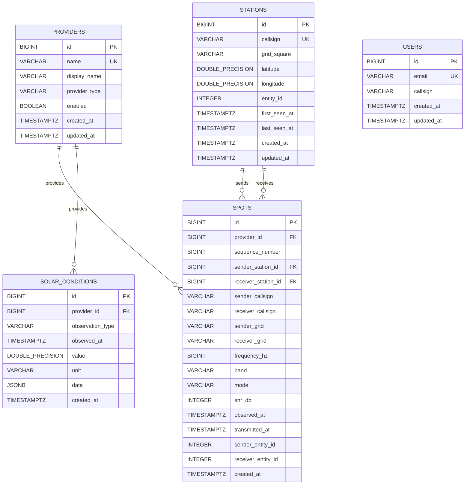

# Radio Atlas Phase 1 Entity Relationship Diagram

## Purpose

This document describes the Phase 1 relational model for Radio Atlas.

The ERD is derived from the logical schema documented in
`Database_Schema.md`.

It documents:

- primary keys;
- foreign keys;
- entity relationships;
- planned uniqueness rules; and
- planned indexes.

## Primary Keys

All Phase 1 tables use surrogate `BIGINT` identity primary keys.

| Table | Primary Key |
|---|---|
| `providers` | `id` |
| `users` | `id` |
| `stations` | `id` |
| `spots` | `id` |
| `solar_conditions` | `id` |

## Foreign Keys

| Table | Column | References | Nullable |
|---|---|---|---|
| `spots` | `provider_id` | `providers.id` | No |
| `spots` | `sender_station_id` | `stations.id` | Yes |
| `spots` | `receiver_station_id` | `stations.id` | Yes |
| `solar_conditions` | `provider_id` | `providers.id` | No |

## Relationships

### Provider to Spots

One provider may produce many spots.

`providers.id` → `spots.provider_id`

Cardinality:

`providers 1 : many spots`

### Provider to Solar Conditions

One provider may produce many solar-condition observations.

`providers.id` → `solar_conditions.provider_id`

Cardinality:

`providers 1 : many solar_conditions`

### Station to Spots as Sender

A station may appear as the sender on many spots.

`stations.id` → `spots.sender_station_id`

Cardinality:

`stations 1 : many spots`

### Station to Spots as Receiver

A station may appear as the receiver on many spots.

`stations.id` → `spots.receiver_station_id`

Cardinality:

`stations 1 : many spots`

### Users

The `users` table has no Phase 1 foreign-key relationship to
`stations`.

A user account and an observed radio station are separate concepts.
A future user-to-station association may be added if required.

## Uniqueness Rules

### Providers

`providers.name` must be unique.

### Users

`users.email` must be unique.

### Stations

`stations.callsign` must be unique.

### PSK Reporter Spots

When `sequence_number` is available:

`provider_id + sequence_number`

forms the canonical upstream identity.

When `sequence_number` is unavailable, the fallback identity is:

- `provider_id`
- `observed_at`
- `sender_callsign`
- `receiver_callsign`
- `frequency_hz`
- `mode`

### Solar Conditions

Solar conditions are uniquely identified by:

- `provider_id`
- `observation_type`
- `observed_at`

## Planned Indexes

The physical indexes will be implemented in Story 6.3.

### Providers

- unique index on `name`

### Users

- unique index on `email`

### Stations

- unique index on `callsign`

### Spots

Planned indexes:

- `(provider_id, sequence_number)` where `sequence_number IS NOT NULL`
- fallback uniqueness index for spots without sequence numbers
- `observed_at`
- `band`
- `(band, observed_at)`
- `sender_station_id`
- `receiver_station_id`
- `sender_callsign`
- `receiver_callsign`

### Solar Conditions

Planned indexes:

- unique `(provider_id, observation_type, observed_at)`
- `observed_at`
- `observation_type`
- `(observation_type, observed_at)`

## Implementation Notes

This ERD represents the logical Phase 1 database design.

Story 6.3 will translate this design into:

- SQLAlchemy persistence models;
- Alembic migrations;
- foreign-key constraints;
- unique constraints;
- indexes; and
- rollback procedures.

Story 6.4 will verify the resulting schema through database integration
tests.

