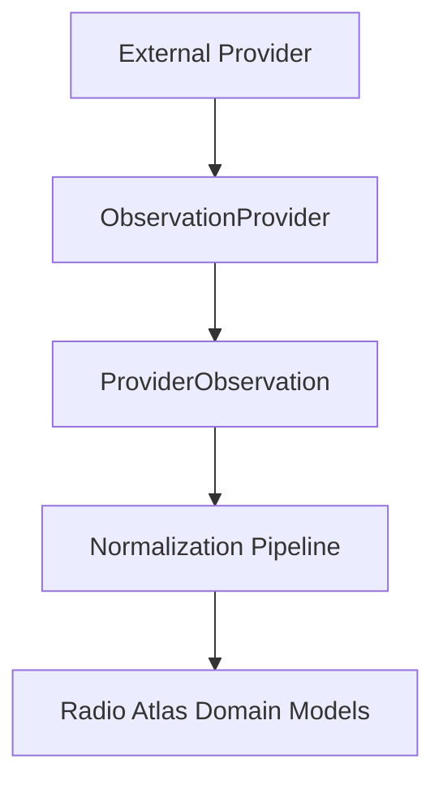
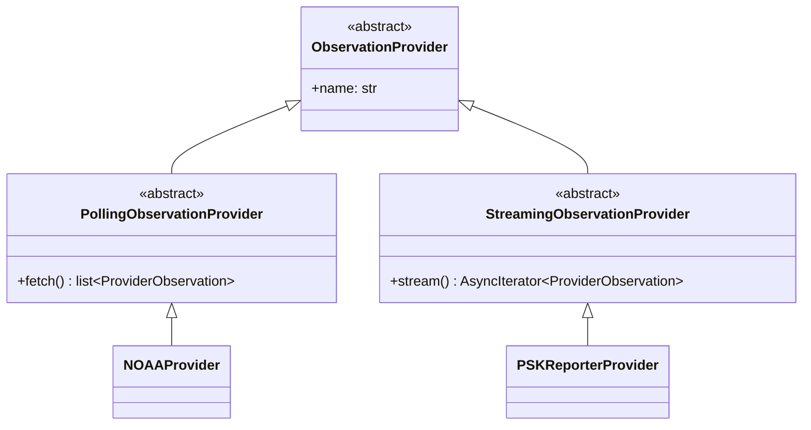
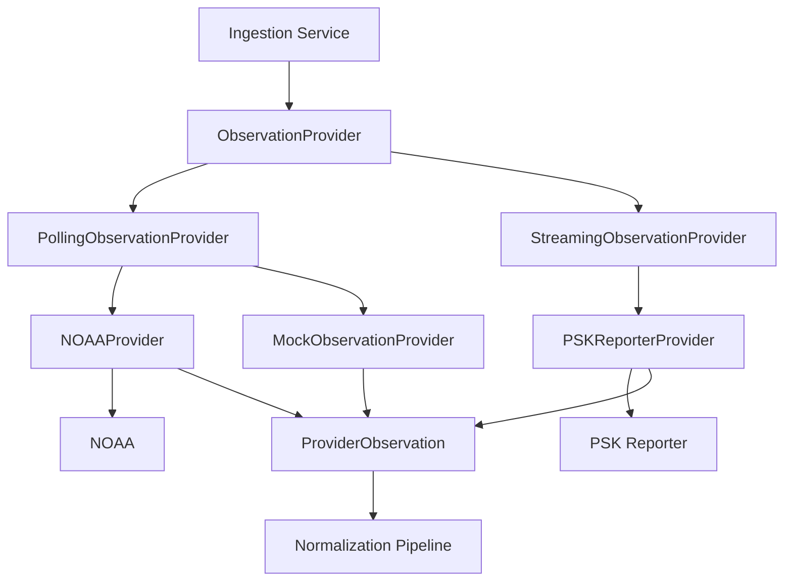
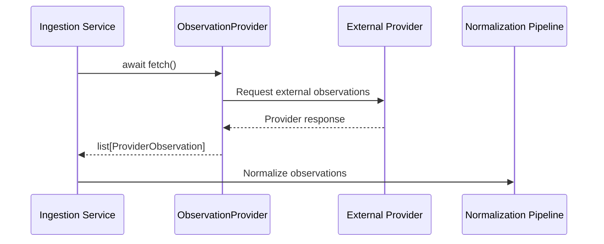
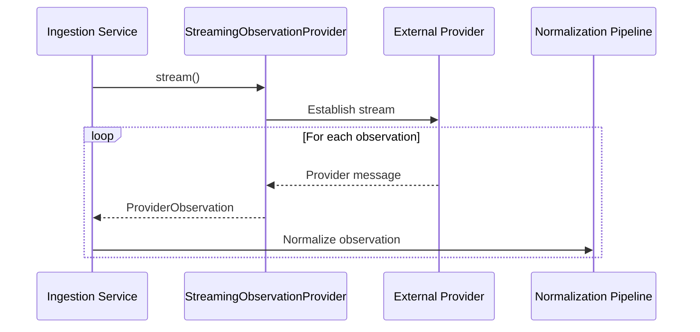
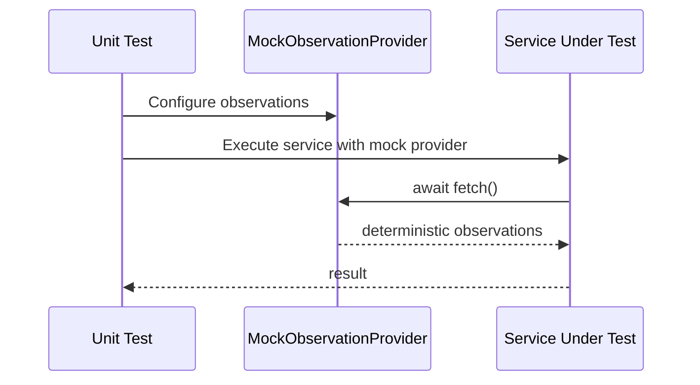

# Provider Contracts

## Purpose

External data sources in Radio Atlas are accessed through provider
implementations.

Providers isolate external systems from the rest of the application.
Application services should depend on the common `ObservationProvider`
interface rather than provider-specific APIs.

This allows NOAA, PSK Reporter, and future data sources to participate in
the ingestion architecture through a consistent contract.

## Contract Summary

Every provider must implement ObservationProvider and one supported
execution contract: PollingObservationProvider or
StreamingObservationProvider.

Every provider must:

| Requirement | Mandatory |
| --- | --- |
| Implement `ObservationProvider` | Yes |
| Implement `name` | Yes |
| Implement `supported execution contract` | Yes |
| Use asynchronous operations | Yes |
| Produce `ProviderObservation` instances | Yes |
| Provide unit tests | Yes |

## Provider Contract

Radio Atlas supports two provider execution models:

- Polling providers fetch a finite batch of observations.
- Streaming providers yield observations continuously.

All providers share a common identity contract and then implement the
execution model appropriate to their source.

```python
class ObservationProvider(ABC):
    @property
    @abstractmethod
    def name(self) -> str: ...


class PollingObservationProvider(ObservationProvider):
    @abstractmethod
    async def fetch(self) -> list[ProviderObservation]: ...


class StreamingObservationProvider(ObservationProvider):
    @abstractmethod
    def stream(self) -> AsyncIterator[ProviderObservation]: ...
```

### NOAA

`NOAAProvider` implements `PollingObservationProvider`.

NOAA is polled periodically and returns a finite batch of normalized
`ProviderObservation` records from each fetch cycle.

### PSK Reporter

`PSKReporterProvider` implements `StreamingObservationProvider`.

PSK Reporter consumes the MQTT stream continuously and yields normalized
`ProviderObservation` records as messages arrive.

## Provider Architecture





## ObservationProvider Interface

All external data providers must implement `ObservationProvider`.

The common interface defines provider identity only. Providers then implement
the execution contract appropriate to their data source.

```python
class ObservationProvider(ABC):
    @property
    @abstractmethod
    def name(self) -> str:
        """Return the unique provider name."""
``

### PollingObservationProvider

Polling providers retrieve a finite batch of observations.

```python
class PollingObservationProvider(ObservationProvider):
    @abstractmethod
    async def fetch(self) -> list[ProviderObservation]:
        """Fetch a batch of observations from the external provider."""
```

### StreamingObservationProvider

Streaming providers yield observations continuously.

```python
class StreamingObservationProvider(ObservationProvider):
    @abstractmethod
    def stream(self) -> AsyncIterator[ProviderObservation]:
        """Stream observations from the external provider."""
```

### Required Methods

All providers must expose a unique `name`.

Polling providers must implement asynchronous `fetch()` and return a finite
`list[ProviderObservation]`.

Streaming providers must implement `stream()` and yield
`ProviderObservation` instances asynchronously.

## ProviderObservation

`ProviderObservation` represents data returned from an external provider
before it enters the Radio Atlas normalization layer.

```python
@dataclass(frozen=True)
class ProviderObservation:
    provider: str
    data: dict[str, Any]
```

### Fields

| Field | Type | Description |
| --- | --- | --- |
| `provider` | `str` | The source of the observation |
| `data` | `dict[str, Any]` | The raw provider-specific payload |

`ProviderObservation` intentionally remains provider agnostic and
represents only the common contract between external providers and the
normalization pipeline. 
Normalization into Radio Atlas domain models occurs later in the ingestion
pipeline.

## Provider Responsibilities

A provider is responsible for:

- Communicating with its external data source
- Constructing provider-specific requests
- Performing asynchronous I/O
- Receiving external responses
- Performing basic response parsing
- Associating returned data with the correct provider
- Returning data through the common provider contract
- Raising or surfacing provider failures in a predictable way
- Converting external responses into `ProviderObservation` objects

## Provider Boundaries

A provider is not responsible for:

- Database persistence
- Application routing
- API response formatting
- Cross-provider normalization
- Domain-level deduplication
- Scheduling ingestion jobs
- User-facing presentation logic
- Domain model creation

## Asynchronous Behavior

Provider operations that access external services must be asynchronous.

Polling providers are consumed with:

```python
observations = await provider.fetch()
```

Streaming providers are consumed with:

```python
async for observation in provider.stream():
    ...
```
Provider implementations should avoid blocking operations in either execution
model.

## Error Handling Expectations

Provider implementations should surface external failures in a consistent,
predictable way and should never silently discard errors.

Provider-specific implementations are responsible for translating
external communication failures into predictable application behavior.

Retry policies, timeout behavior, rate limiting, and structured error
handling may vary by provider and are defined by the corresponding
provider implementation stories.

## Testing Requirements

Every provider implementation should have unit tests verifying that it:

- Implements `ObservationProvider`
- Implements the correct execution contract
- Exposes the expected provider name
- Produces `ProviderObservation` instances
- Handles provider-specific failure conditions
- Preserves cancellation behavior where applicable

Polling providers should additionally test finite fetch results and empty
results.

Streaming providers should additionally test yielded observations,
reconnection behavior, and stream cancellation.

## Adding a New Provider

To add a provider:

1. Create a provider implementation under `app/providers/`.
2. Subclass either `PollingObservationProvider` or
   `StreamingObservationProvider`.
3. Implement the `name` property.
4. Implement the execution method required by the chosen contract.
5. Produce `ProviderObservation` instances.
6. Add unit tests for the provider contract.
7. Export the provider from `app.providers` if it is part of the public
   provider API.

### Example

```python
from app.providers.base import (
    PollingObservationProvider,
    ProviderObservation,
)


class ExampleProvider(PollingObservationProvider):
    @property
    def name(self) -> str:
        return "example"

    async def fetch(self) -> list[ProviderObservation]:
        return []
```

## Architecture Diagrams



The provider layer separates external services from the internal domain model.

Providers retrieve and transform external data into `ProviderObservation`
objects. Normalization into Radio Atlas domain models occurs later in the
ingestion pipeline.

## Polling Provider Sequence



## Streaming Provider Sequence



## Mock Provider Test Sequence



## Source Code

The executable provider contract is defined in:

- `backend/app/providers/base.py`
- `backend/app/providers/mock.py`
- `backend/app/providers/noaa.py`
- `backend/app/providers/psk_reporter.py`

Contract tests are located in:

- `backend/tests/unit/providers/test_provider_contract.py`

When documentation and implementation disagree, the executable contract
and its tests are the authoritative behavior.

Documentation should be updated whenever changes are made to:

- `ObservationProvider`
- `PollingObservationProvider`
- `StreamingObservationProvider`
- `ProviderObservation`
- concrete provider execution models
