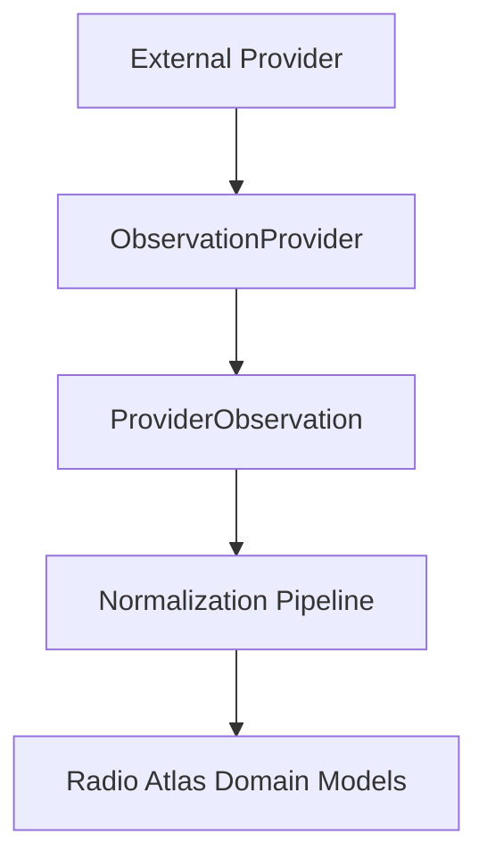
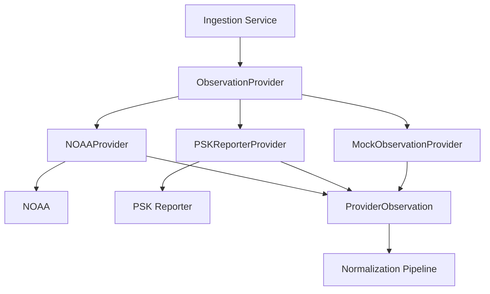
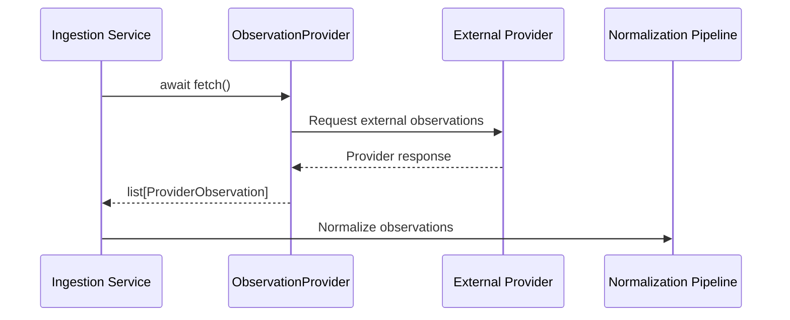
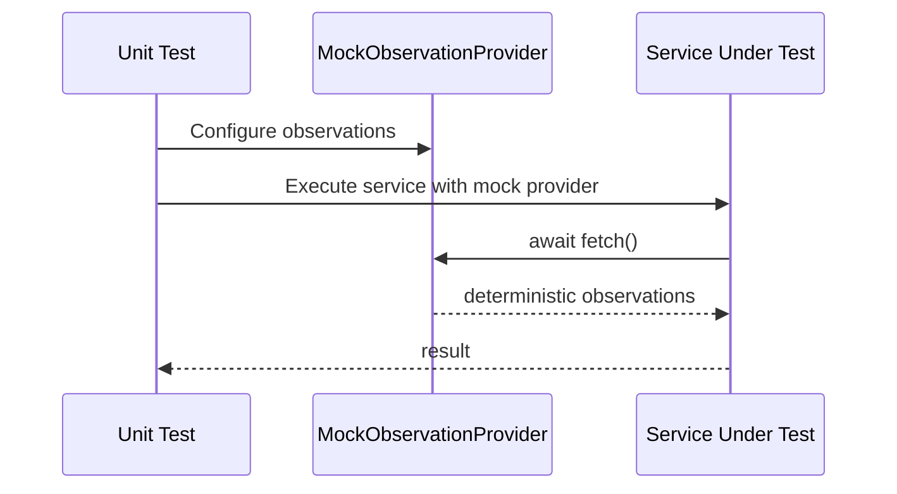

# Provider Contracts

## Purpose

External data sources in Radio Atlas are accessed through provider
implementations.

Providers isolate external systems from the rest of the application.
Application services should depend on the common `ObservationProvider`
interface rather than provider-specific APIs.

This allows NOAA, PSK Reporter, and future data sources to participate in
the ingestion architecture through a consistent contract.

## Contract Summary
    
Every provider must:
    
| Requirement | Mandatory |
| --- | --- |
| Implement `ObservationProvider` | Yes |
| Implement `name` | Yes |
| Implement `fetch()` | Yes |
| Use asynchronous operations | Yes |
| Return `list[ProviderObservation]` | Yes |
| Provide unit tests | Yes |

## Provider Architecture



## ObservationProvider Interface

All external data providers must implement `ObservationProvider`.

The interface defines the minimum behavior required for participation in
the Radio Atlas ingestion system.

```python
class ObservationProvider(ABC):
    @property
    @abstractmethod
    def name(self) -> str:
        """Return the unique provider name."""

    @abstractmethod
    async def fetch(self) -> list[ProviderObservation]:
        """Fetch observations from the external provider."""
```
### Required Methods

#### `name`

Returns the provider's unique identifier.

Examples:

- `mock`
- `noaa`
- `psk_reporter`

#### `fetch`

Retrieves observations from the external data source.

The method must:

- Be asynchronous
- Return a `list[ProviderObservation]`
- Return an empty list when no observations are available
- Never return `None`

## ProviderObservation

`ProviderObservation` represents data returned from an external provider
before it enters the Radio Atlas normalization layer.

```python
@dataclass(frozen=True)
class ProviderObservation:
    provider: str
    data: dict[str, Any]
```

### Fields

| Field | Type | Description |
| --- | --- | --- |
| `provider` | `str` | The source of the observation |
| `data` | `dict[str, Any]` | The raw provider-specific payload |

`ProviderObservation` intentionally remains provider agnostic and
represents only the common contract between external providers and the
normalization pipeline. 
Normalization into Radio Atlas domain models occurs later in the ingestion
pipeline.

## Provider Responsibilities

A provider is responsible for:

- Communicating with its external data source
- Constructing provider-specific requests
- Performing asynchronous I/O
- Receiving external responses
- Performing basic response parsing
- Associating returned data with the correct provider
- Returning data through the common provider contract
- Raising or surfacing provider failures in a predictable way
- Converting external responses into `ProviderObservation` objects

## Provider Boundaries

A provider is not responsible for:

- Database persistence
- Application routing
- API response formatting
- Cross-provider normalization
- Domain-level deduplication
- Scheduling ingestion jobs
- User-facing presentation logic
- Domain model creation

## Asynchronous Behavior

Provider operations that access external services must be asynchronous.

Consumers call providers using:

```python
observations = await provider.fetch()
```
Future provider implementations should avoid blocking operations inside
fetch().

## Error Handling Expectations

Provider implementations should surface external failures in a consistent,
predictable way and should never silently discard errors.

Provider-specific implementations are responsible for translating
external communication failures into predictable application behavior.

Retry policies, timeout behavior, rate limiting, and structured error
handling may vary by provider and are defined by the corresponding
provider implementation stories.

## Testing Requirements

Every provider implementation should have unit tests verifying that it:

- Implements `ObservationProvider`
- Exposes the expected provider name
- Implements asynchronous `fetch()`
- Returns `ProviderObservation` instances
- Handles empty results
- Handles provider-specific failure conditions

Tests that consume providers should prefer mock providers when external
network access is not part of the behavior under test.

## Adding a New Provider

To add a provider:

1. Create a provider implementation under `app/providers/`.
2. Subclass `ObservationProvider`.
3. Implement the `name` property.
4. Implement asynchronous `fetch()`.
5. Return a `list[ProviderObservation]`.
6. Add unit tests for the provider contract.
7. Export the provider from `app.providers` if it is part of the public provider API.

### Example

```python
from app.providers.base import (
    ObservationProvider,
    ProviderObservation,
)


class ExampleProvider(ObservationProvider):
    @property
    def name(self) -> str:
        return "example"

    async def fetch(self) -> list[ProviderObservation]:
        return []
```

## Architecture Diagrams


The provider layer separates external services from the internal domain model.

Providers retrieve and transform external data into `ProviderObservation`
objects. Normalization into Radio Atlas domain models occurs later in the
ingestion pipeline.

## Provider Fetch Sequence



## Mock Provider Test Sequence



## Source Code

The executable provider contract is defined in:

- `backend/app/providers/base.py`
- `backend/app/providers/mock.py`

Contract tests are located in:

- `backend/tests/unit/providers/test_provider_contract.py`

When documentation and implementation disagree, the executable contract
and its tests are the authoritative behavior.

Documentation should be updated whenever changes are made to:

- `ObservationProvider`
- `ProviderObservation`
- `MockObservationProvider`

