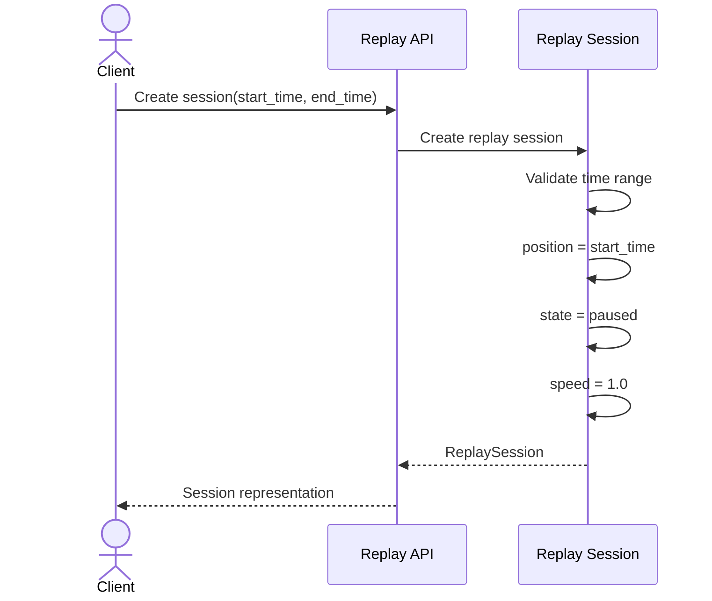
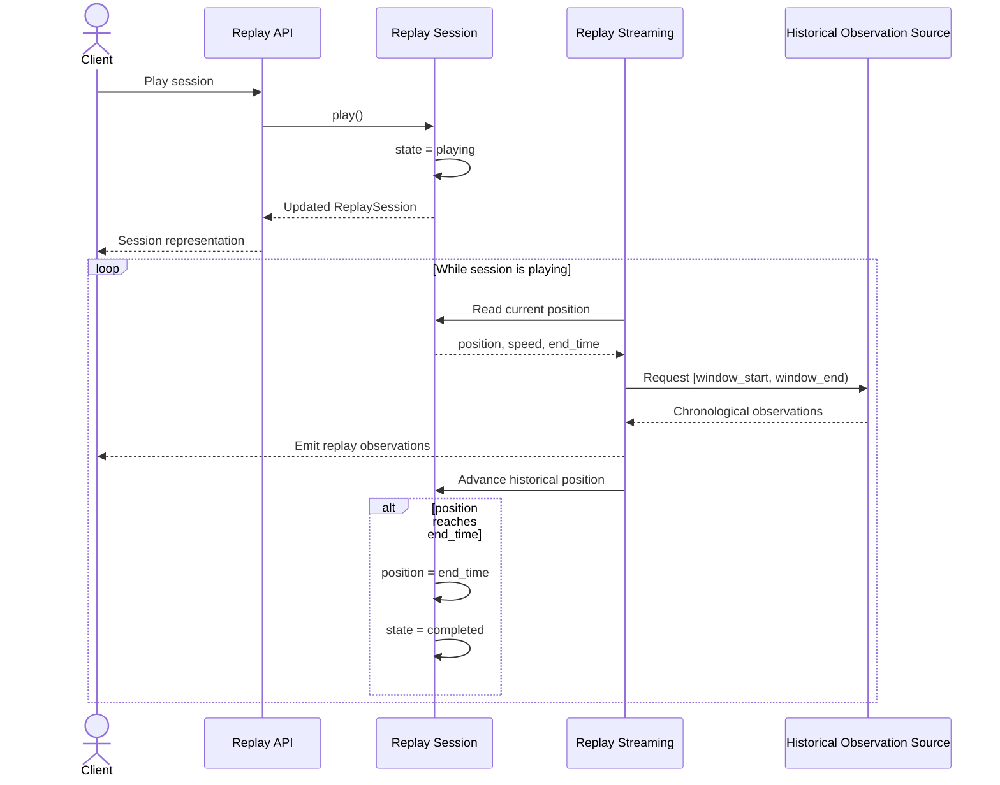
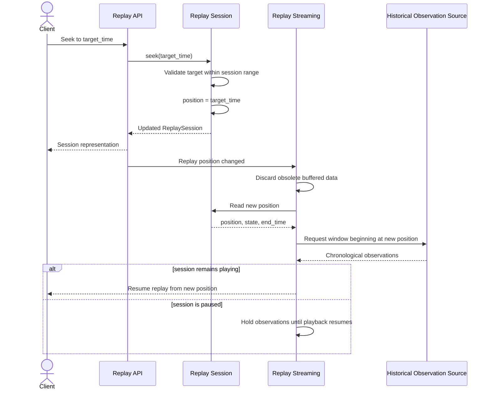

# Replay Architecture

## Purpose

The [timeline data model](Timeline_Data_Model.md) defines density summaries and
notable-activity markers for navigating replay history. Timeline resolution
does not change the precise seek and playback semantics specified here.

The Phase 3 replay engine provides deterministic historical playback of Radio
Atlas observations across a requested UTC time range.

Replay separates playback behavior from historical data retrieval. A replay
session manages time, playback state, speed, and progression without depending
on PostgreSQL, SQLAlchemy models, API response models, or a specific
observation provider.

Historical observations remain the underlying source of replay data. The
mechanism used to retrieve and stream those observations is defined separately
from the replay session contract.

## ReplaySession Contract

A `ReplaySession` represents one historical playback session.

The session owns playback state and historical-time progression. It does not
own the persistence or query mechanism used to obtain observations.

A replay session contains:

- `session_id`: stable identifier for the replay session
- `start_time`: inclusive UTC beginning of the requested historical range
- `end_time`: exclusive UTC end of the requested historical range
- `position`: current UTC playback position within the requested range
- `state`: current playback state
- `speed`: multiplier controlling how quickly historical time advances relative
  to wall-clock time
- `created_at`: UTC timestamp when the session was created
- `updated_at`: UTC timestamp of the most recent session-state change

The initial playback position is `start_time`.

The initial playback state is `paused`.

The initial playback speed is `1.0`.

A replay session must satisfy:

`start_time < end_time`

and:

`start_time <= position <= end_time`

### Data-Source Independence

`ReplaySession` must not depend directly on:

- SQLAlchemy sessions or database models
- PostgreSQL-specific behavior
- API request or response models
- offset or cursor pagination
- PSK Reporter or another observation provider
- frontend rendering state

The replay engine consumes historical observations through a separate retrieval
boundary. This allows the same playback behavior to operate against database
queries, test fixtures, or future historical data sources.

The retrieval and streaming implementation is introduced separately from the
session contract.

## Playback State Machine

A replay session has three playback states:

- `paused`: historical time is not advancing
- `playing`: historical time advances according to the configured playback speed
- `completed`: playback has reached the end of the requested historical range

New sessions begin in `paused`.

### State Transitions

The supported transitions are:

| Current State | Action | Resulting State |
| --- | --- | --- |
| `paused` | play | `playing` |
| `paused` | seek | `paused` |
| `playing` | pause | `paused` |
| `playing` | seek | `playing` |
| `playing` | reach `end_time` | `completed` |
| `completed` | seek before `end_time` | `paused` |
| `completed` | play | `completed` |
| any state | seek to `end_time` | `completed` |

A `play` action while already `playing` is idempotent.

A `pause` action while already `paused` is idempotent.

A `play` action while `completed` does not implicitly rewind the session.
The session remains `completed` until it is explicitly sought to a position
before `end_time`.

Seeking exactly to `end_time` places the session in `completed`, regardless of
its previous playback state.

Seeking changes the historical playback position without implicitly starting
playback. When seeking during active playback, the session remains `playing`.

Seeking a completed session to a position before `end_time` returns the session
to `paused`. The user must explicitly resume playback.

### Completion

When playback progression reaches or passes `end_time`, the session position is
clamped to `end_time` and the state becomes `completed`.

A completed session does not advance further until it is explicitly repositioned
through a seek operation.

### Playback Speed

Playback speed is represented as a positive multiplier of historical time
relative to wall-clock time.

For example:

- `1.0` means one second of historical time advances per second of wall-clock
  time
- `2.0` means two seconds of historical time advance per second of wall-clock
  time
- `10.0` means ten seconds of historical time advance per second of wall-clock
  time

Playback speed must be greater than zero.

Changing playback speed does not change the current playback state or position.

## Time-Window Semantics

Replay divides the requested historical range into chronological playback
windows.

A playback window is represented as:

`[window_start, window_end)`

The start is inclusive and the end is exclusive.

An observation belongs to a playback window when:

`window_start <= observed_at < window_end`

Using half-open intervals ensures that an observation occurring exactly on a
window boundary belongs to exactly one window and is not emitted twice.

### Advancement and Emission

When playback advances from historical position `A` to historical position
`B`, the logical playback interval is:

`[A, B)`

Observations satisfying:

`A <= observed_at < B`

are eligible for emission during that advancement.

The session position becomes `B` after the advancement is processed.

This rule ensures adjacent advancements do not emit the same observation
twice. An observation exactly at `B` belongs to the next playback interval.

When the final advancement reaches `end_time`, observations before `end_time`
are eligible for emission and the session then becomes `completed`.
Observations exactly at `end_time` are outside the replay session's requested
half-open range and are not emitted.

A seek changes the playback position but does not itself emit observations.
Observation emission resumes from the new position when playback subsequently
advances.

### Replay Clock

`position` represents the replay session's current historical UTC time.

While the session is `playing`, historical time advances according to elapsed
wall-clock time and the configured playback speed:

`historical_elapsed = wall_clock_elapsed * speed`

The resulting position must never advance beyond `end_time`.

Wall-clock time controls the rate of progression only. Observation timestamps
and replay positions remain historical UTC timestamps.

### Window Progression

Playback windows progress chronologically from `start_time` toward `end_time`.

Each window:

- begins at the previous window's exclusive endpoint
- does not extend beyond the session's `end_time`
- emits only observations whose `observed_at` timestamps fall within that
  window
- preserves chronological observation ordering

The final window may be shorter than the normal playback window duration.

The replay contract does not prescribe a fixed window duration. Window sizing,
prefetching, pagination, and retrieval optimization belong to the historical
data-retrieval and streaming layers.

### Seeking

A seek sets `position` to a requested historical UTC timestamp.

The requested position must satisfy:

`start_time <= position <= end_time`

Seeking does not require replaying intermediate windows between the previous
and new positions.

After a seek, historical retrieval resumes from the new position. Previously
emitted observations are not implicitly replayed unless the seek moves the
position backward into their historical range.

Consumers must treat a seek as a discontinuity in the playback stream and
replace any transient visualization state that depends on the previous replay
position.

### Observation Time

Replay ordering and window membership use `observed_at` as the canonical
historical timestamp.

`transmitted_at`, when present, remains observation metadata and does not
control replay progression.

This keeps replay behavior consistent with the normalized Radio Atlas
observation history while allowing observations that do not contain a
transmission timestamp to participate in replay.

## Component Architecture

Replay is divided into responsibilities so playback behavior remains
independent of storage, transport, and visualization.

### Replay Session

The replay session owns:

- requested historical range
- current historical position
- playback state
- playback speed
- state transitions
- historical-clock progression

It does not retrieve observations or render them.

### Historical Observation Source

Historical observations are supplied through a retrieval boundary rather than
being queried directly by the replay session.

Conceptually, a historical observation source accepts a UTC time window and
returns observations belonging to that window in chronological order.

The replay architecture does not require a particular implementation of this
boundary. Story 3.2 defines the initial database-backed implementation,
pagination, and prefetching behavior.

### Replay Streaming

The streaming layer coordinates the replay clock with historical observation
retrieval.

Its responsibilities include:

- determining which historical window is needed next
- requesting observations for that window
- delivering observations in replay order
- responding to play, pause, seek, and speed changes
- discarding obsolete prefetched data after a seek
- preventing observations from being emitted outside the session range

Streaming does not define observation persistence or frontend visualization
behavior.

### Replay API

The API exposes replay-session lifecycle and control operations to clients.

The API translates transport-level requests into replay operations but does
not define the replay state machine itself.

Session creation, retrieval, mutation, and playback streaming endpoints are
implemented in later Replay Engine stories.

### Replay Consumer

A replay consumer receives historical playback data and renders or otherwise
processes it.

The Phase 3 frontend consumer will integrate replay with the existing Radio
Weather Globe renderer. The replay engine does not depend on that renderer.

This separation allows live observations and historical replay observations to
share visualization infrastructure without coupling replay state to Three.js
or React state.

### Dependency Direction

Dependencies flow toward the replay contracts:

`API -> Replay Session`

`Streaming -> Replay Session`

`Streaming -> Historical Observation Source`

`Frontend -> Replay API / Stream`

The `ReplaySession` contract does not depend on the API, streaming transport,
database, or frontend.

This boundary keeps playback behavior testable using an in-memory historical
observation source before database-backed retrieval or WebSocket delivery is
introduced.

## Sequence Diagrams

The following diagrams describe interactions between replay components. They
define architectural behavior rather than a specific storage or transport
implementation.

### Create Replay Session

Session creation establishes the historical range and playback clock without
retrieving observations. Historical data is requested only when playback
requires it.

### Play Historical Observations

Playback coordinates three independent concerns:

1. `ReplaySession` owns playback state and historical time.
2. `Historical Observation Source` retrieves observations for requested UTC
   windows.
3. `Replay Streaming` coordinates those components and delivers observations
   to the consumer.

The observation source does not determine playback position or state. The
session does not determine how observations are queried, paginated, prefetched,
or transported.

### Seek Replay Position

A seek invalidates buffered or prefetched observations associated with the
previous playback position.

The next retrieval window begins from the new position. The replay engine does
not emit observations from the skipped interval merely because the historical
clock crossed that interval during the seek.

When seeking backward, observations may be emitted again because they once
again fall ahead of the current historical position.

Seeking changes historical position but does not implicitly start a paused
session. A seek performed while playing preserves the `playing` state.

## Replay verification

[Phase 3 Story 3.5 test plan](../testing/Replay_Test_Plan.md) maps the replay
contracts to unit, PostgreSQL-backed HTTP/WebSocket lifecycle, and concurrent
session tests. It includes a reproducible isolated Docker harness and a sequence
diagram for the persisted lifecycle and streaming flow.
