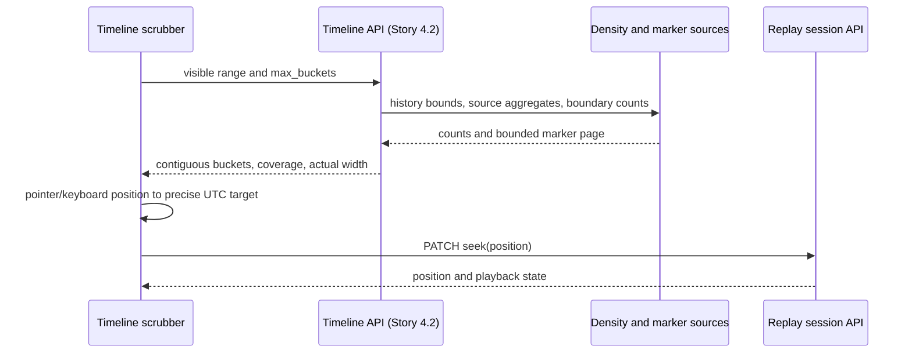

# Timeline Data Model

Phase 3 Story 4.1 designs the density buckets, notable-activity markers, and
transport contract needed to scrub the Radio Weather Globe across its full
observation history. This is a design contract for Stories 4.2–4.4, not an
implemented endpoint, migration, or frontend component.

## Decision record

Use a derived timeline read model over raw `spots` and the existing
`analytics_band_hourly` and `analytics_band_daily` rollups. Do not add timeline
persistence tables. Keep density retrieval, marker providers, and replay state
management separate. The timeline chooses a visible historical position; replay
retrieves observations and determines playback state.

Existing artifacts informing this decision:

- [Analytics aggregation schema](Analytics_Aggregation_Schema.md): UTC rollups,
  rebuildable derived data, and exclusion of spots whose band is unresolved.
- [Replay architecture](Replay_Architecture.md): half-open observation windows,
  precise seeks, and inclusive terminal playback position.
- `app/replay/streaming/queries.py`: grouped hourly activity retrieval, separate
  from raw observation retrieval.
- `app/infrastructure/database/models.py`: indexed `spots.observed_at` and
  hourly/daily band rollup models.

Alternatives: returning raw spots makes overview payloads grow with observation
volume; persisting a second density table duplicates rollup maintenance; choosing
only hourly or daily output leaves response size unbounded as history expands.
The chosen design groups source rollups into dynamically sized display buckets
and reserves raw queries for fine zoom and partial boundaries.

## Time and history semantics

- Accept timezone-aware timestamps and normalize them to UTC. Reject naive
  timestamps and ranges with `start_time >= end_time` using existing API error
  conventions. Preserve microsecond precision and emit RFC 3339 UTC timestamps.
- Observation and bucket intervals are `[start_time, end_time)`. A spot at the
  end belongs to the next interval. Historical ordering uses `observed_at`.
- History bounds are global raw-spot bounds: `start_time = MIN(observed_at)` and
  exclusive `end_time = MAX(observed_at) + 1 microsecond`. Both are null if there
  are no spots. Guard timestamp overflow using the API's supported date range.
- Omitting both request bounds selects full history. Supplying only one is
  invalid. An explicit range can extend outside known history; return empty
  buckets for those portions while retaining the requested axis.
- Empty history with omitted bounds returns null range metadata, no buckets,
  no events, and null bucket width. An explicit range on an empty database still
  returns bounded zero buckets using the fine/raw source.
- History bounds include unresolved-band observations. Density coverage is
  declared separately; zero band-resolved density does not prove no raw spots.

## Proposed request contract

Future endpoint: `GET /api/v1/timeline` (Story 4.2).

| Parameter | Default | Rule |
| --- | --- | --- |
| `start_time`, `end_time` | Both omitted | UTC visible range; both or neither |
| `max_buckets` | 512 | Integer 1–2048; hard bound on returned bucket count |
| `resolution` | `auto` | `auto`, `minute`, `hour`, or `day` |
| `include_events` | true | False avoids marker work while rapidly scrubbing |
| `event_limit` | 100 | Integer 1–500; applies only when events requested |
| `event_cursor` | null | Opaque continuation for the same range and options |

Explicit resolution is a minimum display width, not an instruction to bypass
the bucket cap. Return the actual width and source resolution so the client
can request a smaller visible range to zoom further. Do not add station, band,
or mode filtering in this story; those options would alter coverage and marker
identity and require an explicit contract extension.

## Density buckets and bounded resolution

Let `D` be the requested duration in integer microseconds and `N = max_buckets`.
Select a source unit `U` using integer arithmetic:

- `auto`: minute when `D <= N × 1 minute`, hour when `D <= N × 1 hour`,
  otherwise day.
- Explicit resolution chooses its named source unit.
- Display width `W = U × max(1, ceil(D / (N × U)))`.

Anchor display buckets to the requested start, not the Unix epoch. Produce
`ceil(D / W)` buckets, never exceeding `N`. Bucket `i` starts at
`start_time + i × W` and ends at `min(start_time + (i + 1) × W, end_time)`.
Only the last bucket can be shorter. This defines a contiguous axis across
arbitrarily long history without calendar-month or DST arithmetic. Use aware
UTC datetimes and integer microseconds throughout; do not round via floats.

| Bucket field | Type | Meaning |
| --- | --- | --- |
| `start_time` | UTC timestamp | Inclusive display start |
| `end_time` | UTC timestamp | Exclusive display end, clipped to requested range |
| `observation_count` | Nonnegative integer | Count for this exact interval and declared coverage |
| `normalized_density` | Number in [0, 1] | Count divided by largest count in this response; zero if all counts zero |

Return every display bucket, including zero-count buckets, in time order.
Density normalization is local to this response and must be recalculated on
zoom; it is not a cross-request measure of propagation quality.

### Source selection and partial boundaries

For minute resolution, count raw spots, including unresolved bands, and report
`density_coverage = all_observations`. For hour/day resolution, aggregate band
rollups and report `density_coverage = band_resolved_observations`.

Sum `observation_count` across band/mode rows only for source buckets wholly
inside a display bucket. For partial source buckets at display boundaries,
query raw spots in the exact uncovered intervals with `band IS NOT NULL` for
rollup coverage. Never count a whole hourly/daily bucket and describe that
count as belonging to a clipped interval. Never mix all-spot edge counts with
band-resolved interior counts. Batch edge intervals rather than issuing one
database query per display bucket.

Rollups are eventually refreshed. Missing rows can mean zero activity or
uncomputed history; they cannot establish completeness. Return
`aggregation_status = unknown` unless the service has evidence that the
requested rollup interval is current. `generated_at` is response generation
time, not a rollup watermark. Raw-only output uses `not_applicable`. A future
aggregation watermark can add `complete`/`incomplete`; the implementation
must not fabricate one from `MAX(updated_at)`.

## Notable-activity markers

Keep event producers behind a marker-source interface. Activity markers can
be derived from density without depending on Epic 5 anomaly persistence;
future anomaly providers map their records into the same transport shape.

| Event field | Type | Meaning |
| --- | --- | --- |
| `id` | Nonempty string | Stable within source; safe React key and detail reference |
| `event_type` | String | Initially `activity_peak`; later anomaly categories |
| `source` | String | Initially `timeline_activity`; future producer identifiers |
| `start_time` | UTC timestamp | Event start or point timestamp |
| `end_time` | UTC timestamp or null | Exclusive interval end; null for point event |
| `severity` | `info`, `low`, `medium`, `high` | Presentation-neutral importance |
| `label` | String, at most 160 characters | Plain text, never executable HTML |
| `observation_count` | Nonnegative integer or null | Magnitude when applicable |
| `metadata` | JSON object | Bounded source-specific details, at most 4 KiB |

Proposed initial rule: a positive display count is a peak when it exceeds both
immediate neighbors (missing neighbors are zero) and is at least twice the
median of all visible counts. For a zero median, require at least two spots.
Equal-count plateaus do not generate peaks. Mark the qualifying bucket as an
interval with `severity = info`; these are activity summaries, not detected
anomalies. Story 4.2 implements and tests this rule. Marker identity includes
source, coverage, actual width, and interval boundaries so it stays stable for
the same display bucket but changes appropriately with zoom or range.

Include point events when `start <= timestamp < end`; include intervals when
`event.start < end` and `event.end > start`. Preserve original event boundaries
and clip only their visual drawing. Sort by `(start_time, source, id)` and
deduplicate by `(source, id)`. Return at most `event_limit` and an opaque
`next_event_cursor` when more remain. Cursor binding must cover the range,
resolution, coverage, and source snapshot; reject incompatible cursors. Do not
silently drop overflowing markers. Concurrent historical updates can require
refreshing the marker snapshot; cursor details belong to Story 4.2.

## Response contract and complete example

Top-level fields: `schema_version = 1`, `generated_at`, `history`,
`start_time`, `end_time`, `source_resolution`, `bucket_seconds`,
`density_coverage`, `aggregation_status`, `buckets`, `events`, and
`next_event_cursor`. Empty-history full overview uses null `start_time`,
`end_time`, `source_resolution`, `bucket_seconds`, and `density_coverage`.
`history` always contains nullable `start_time` and `end_time`.

Counts must remain within JavaScript's safe integer range for JSON consumers;
reject an unrepresentable response rather than round counts. Validate limits,
finite densities, contiguous ranges, and event sizes in the transport models.
Use independent default factories for mutable arrays and metadata objects.

```json
{
  "schema_version": 1,
  "generated_at": "2026-10-05T12:00:00Z",
  "history": {
    "start_time": "2026-09-01T00:00:00Z",
    "end_time": "2026-09-01T01:59:59.000001Z"
  },
  "start_time": "2026-09-01T00:00:00Z",
  "end_time": "2026-09-01T02:00:00Z",
  "source_resolution": "hour",
  "bucket_seconds": 3600,
  "density_coverage": "band_resolved_observations",
  "aggregation_status": "unknown",
  "buckets": [
    {
      "start_time": "2026-09-01T00:00:00Z",
      "end_time": "2026-09-01T01:00:00Z",
      "observation_count": 4,
      "normalized_density": 1
    },
    {
      "start_time": "2026-09-01T01:00:00Z",
      "end_time": "2026-09-01T02:00:00Z",
      "observation_count": 0,
      "normalized_density": 0
    }
  ],
  "events": [
    {
      "id": "activity:band-resolved:3600:20260901T000000Z:20260901T010000Z",
      "event_type": "activity_peak",
      "source": "timeline_activity",
      "start_time": "2026-09-01T00:00:00Z",
      "end_time": "2026-09-01T01:00:00Z",
      "severity": "info",
      "label": "Elevated radio activity",
      "observation_count": 4,
      "metadata": {}
    }
  ],
  "next_event_cursor": null
}
```

## Scrubbing and replay handoff

Map a pointer/keyboard position to an exact timestamp within the visible
range, not to the bucket center or start. Clamp it to the replay session's
`[start_time, end_time]`. Send `PATCH /api/v1/replay/sessions/{id}` with
`action = seek` and that UTC `position`. Seeking to the terminal endpoint is
valid and completes replay, even though density intervals exclude their ends.
Changing zoom or fetching timeline density does not itself seek or play.



## Implementation boundaries and acceptance

Story 4.2 adds domain models, grouped queries, a timeline service, transport
validation, endpoint registration, and OpenAPI documentation. Story 4.3 adds
the accessible scrubber; Story 4.4 tests the end-to-end interaction. Epic 5
owns anomaly modeling and persistence. No infrastructure or public endpoint
changes are made in Story 4.1.

| Story 4.1 requirement | Design evidence |
| --- | --- |
| Scrub across full history | Raw history bounds, bounded adaptive widths, exact seek timestamp |
| Density buckets | Contiguous clipped intervals, zero fill, normalized counts, source coverage |
| Event markers | Producer-independent shape, deterministic peaks, bounded pagination |
| Document contract | Request rules, full JSON example, sequence diagram, acceptance test plan |

See [Timeline test plan](../testing/Timeline_Test_Plan.md) for deterministic
cases and the worked bucket-cap example. This document establishes the design;
runtime acceptance for timeline retrieval awaits Story 4.2.
