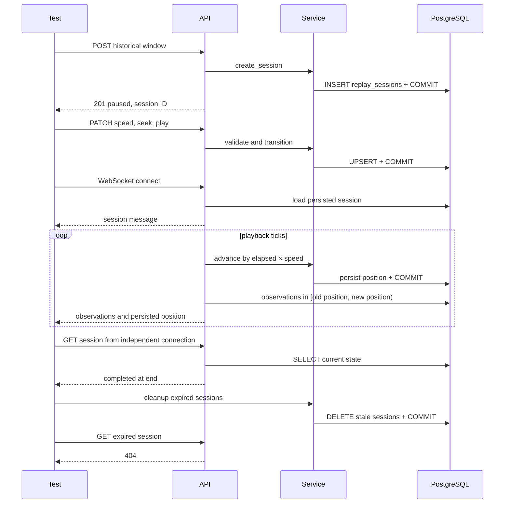

# Phase 3 Story 3.5: replay engine verification

Acceptance criterion: replay tests pass. Run the commands below before declaring the
story verified; authoring tests alone does not meet the acceptance criterion.

## Coverage and evidence

| Requirement | Existing coverage | Added coverage |
| --- | --- | --- |
| State machine | Basic transitions, invalid windows, idempotent controls | Full state/seek boundary matrix; rejected seeks leave all fields unchanged; completed advances are no-ops |
| Session lifecycle | Mocked service/API tests; repository round trips | POST/PATCH/GET with real PostgreSQL and independent sessions, committed updates, completion/restart, expiry visible as HTTP 404 |
| Varying speeds | Single 2x advancement | Fractional ticks at 0.25x–16x, changes during playback, pause/resume, real persisted advancement and WebSocket frames at 0.5x/1x/2x |
| Seek accuracy | Basic within/outside-window checks | Microsecond precision, inclusive seek endpoints, one microsecond outside bounds, persisted precision and state |
| Streaming | Mocked route frames; isolated paging tests | Real seeded database queries through WebSocket; half-open frames neither duplicate boundaries nor emit the end timestamp |
| Concurrent sessions | None | 32 independent HTTP lifecycles across 8 workers, unique IDs, per-session speeds/positions, committed row counts and latency output |

Fixtures use fixed historical timestamps and synthetic observations. UUIDs isolate database
identities; assertions never depend on UUID values or real provider data. Only database
connection provisioning and the WebSocket tick interval are overridden. Replay services,
state models, PostgreSQL upserts, observation queries and streaming ticks remain real.
The application ingestion lifespan is deliberately not started.

## Isolated execution

From the repository root, provide test PostgreSQL settings through the existing
`.env.example`; do not point these tests at a shared database. The new lifecycle fixture
requires the database name `radio_atlas_replay_test`. The standalone Compose file exposes
no host ports and uses a PostgreSQL tmpfs, separate from the development stack.

```sh
docker compose --env-file .env.example -p radio-atlas-story35 \
  -f docker-compose.replay-tests.yml build tests
docker compose --env-file .env.example -p radio-atlas-story35 \
  -f docker-compose.replay-tests.yml run --rm tests
docker compose --env-file .env.example -p radio-atlas-story35 \
  -f docker-compose.replay-tests.yml run --rm tests \
  ruff format --check tests/integration/replay/test_lifecycle.py \
  tests/unit/replay/session/test_playback_matrix.py
docker compose --env-file .env.example -p radio-atlas-story35 \
  -f docker-compose.replay-tests.yml run --rm tests \
  ruff check tests/integration/replay/test_lifecycle.py \
  tests/unit/replay/session/test_playback_matrix.py
docker compose --env-file .env.example -p radio-atlas-story35 \
  -f docker-compose.replay-tests.yml down --volumes
```

The default test command runs `alembic upgrade head` before unit, repository, API and
integration replay tests, and requires at least 85% statement coverage of `app.replay`.
This exercises the actual migration chain against a clean PostgreSQL instance. Backend
dependencies are installed only in the image. The bind mount also exposes current
migrations, avoiding stale migration files baked into an earlier image.

For a larger independent-session load sample:

```sh
REPLAY_LOAD_SESSIONS=128 REPLAY_LOAD_WORKERS=16 \
  docker compose --env-file .env.example -p radio-atlas-story35 \
  -f docker-compose.replay-tests.yml run --rm tests
```

Each load lifecycle performs create, speed, seek, play, committed advancement, pause,
and fetch. The harness asserts correctness and prints total duration, completed sessions
per second, lifecycle p95 and maximum latency. The clock measures whole lifecycles,
including worker request scheduling. It uses in-process ASGI requests and real database
connections; it does not measure deployment network latency, Uvicorn capacity, concurrent
WebSocket capacity, or same-session competing writers. No timing thresholds are asserted
before establishing a reproducible baseline. Session counts are bounded to 1–1000 and
workers to 1–64. Do not run these integration tests with pytest-xdist: expiry operates on
all stale sessions in the disposable database.

## Lifecycle and streaming sequence



## Validation record

On 2026-10-03, Docker client discovery succeeded but server access failed:
`permission denied while trying to connect to the docker API at
unix:///Users/kellysimer/.docker/run/docker.sock`.

Ruff formatting and lint checks were run using the already installed formatter, without
installing host dependencies. Python syntax, Compose configuration validation and Git whitespace checks also passed.

On 2026-10-04, the developer ran the isolated Docker command above and supplied its
terminal output. The image built successfully, PostgreSQL became healthy, and all three
migrations completed, including replay session revision `8aab0b72d8f1`.

- **Tests:** 124 passed in 6.08 seconds, with one non-failing Starlette TestClient
  deprecation warning about `httpx`.
- **Replay statement coverage:** 97.56%, exceeding the required 85%.
- **Concurrent lifecycle sample:** 32 sessions across 8 workers; duration 1.967 seconds,
  throughput 16.268 sessions/second, lifecycle p95 0.563 seconds, maximum 0.614 seconds.

```text
replay_load sessions=32 workers=8 duration_s=1.967 sessions_per_s=16.268 lifecycle_p95_s=0.563 lifecycle_max_s=0.614
```

This developer-executed run satisfies Story 3.5's acceptance criterion that replay tests
pass. These timings represent one in-process ASGI/database sample, not deployed network
or concurrent WebSocket performance. Agent-side Docker access remains restricted; the
runtime evidence comes from the supplied developer output.
