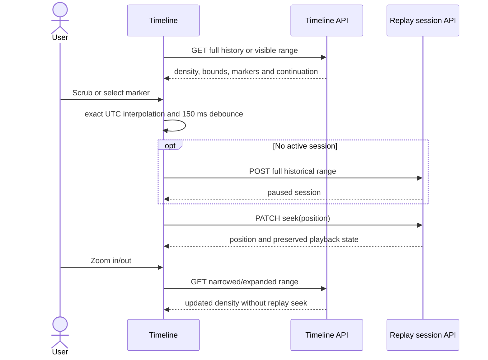

# Story 4.3: timeline scrubbing

The Radio Weather Globe's existing activity panel now includes a historical
timeline. The native range input supports pointer interaction, arrow keys,
Home, and End. Density bars have an accessible text list; marker buttons seek
to their UTC timestamp. Zoom and full-history navigation fetch new density
without changing playback position.

Following manual usability feedback on 2026-10-09, the pane now provides an
**Expand timeline** action opening a full-screen native modal dialog. Escape
and the close button return to the dock with selection preserved and keyboard
focus restored. The background is inert while the dialog is open.

The graph has five readable UTC date/time ticks (three on narrow screens), a
legend, a selected-time cursor, and a selected-interval report count. **Show
less time** halves the visible duration; **Show more time** doubles it; **All
history** restores the complete range. Visible dates and duration explain
each change. Busy-period cards are directly actionable without opening raw
details. Optional report details use a formatted table rather than ISO strings.

## Integration decisions

- Load `/api/v1/timeline` with bounded density and event-page limits. Abort
  obsolete range queries and marker pages so slow responses cannot replace
  the current viewport.
- Keep UTC coordinates as integer microseconds. JavaScript `Date` is used for
  whole-second formatting only; interpolation and zoom use `bigint`, preserving
  endpoints and histories shorter than a millisecond.
- Debounce input for 150 milliseconds and serialize seek requests. Replace
  queued inputs with the most recent target while a request is in progress.
- Create a paused session spanning the available history on the first seek.
  Reuse it thereafter. A 404 triggers one session recreation and retry; other
  errors remain visible with a retry action. Backend expiry owns cleanup.
- Following additional manual feedback, visible Beginning/End and Play/Pause
  controls now complement keyboard Home/End. Speed can be real time, one minute
  per second, or one hour per second. The backend WebSocket stream advances
  the replay clock and updates the selected timestamp; connections retry after
  a disconnect. Policy/expiry closure requests a fresh seek rather than looping.
- The current frontend has no historical globe frame bridge. These controls
  advance the timeline clock; the globe continues showing live observations.
  Globe frame rendering remains Story 6.1. No backend endpoint changes are made.

## Seek sequence



## Automated verification

Unit/component tests cover microsecond and pre-epoch timestamps, tiny history,
zoom clamping, exact terminal seek, input debouncing, request ordering, expiry,
failed requests, retries, stale results, marker continuation, and unmount cleanup.
API tests assert request URLs, signals, payloads, and error propagation.

Run from the repository root; no `.env` file or backend service is required:

```sh
docker compose -p radio-atlas-story43 -f docker-compose.frontend-tests.yml \
  run --build --rm tests
docker compose -p radio-atlas-story43 -f docker-compose.frontend-tests.yml down
```

Dependencies, lint, build, and Vitest execute inside the container. The image
requires 85% lines, statements, and functions coverage for the modified timeline
and API modules; fixture data is excluded from instrumentation.

Agent-side Docker execution remains blocked by socket permissions. TypeScript
type checks and ESLint were run with existing tools, without dependency installs.
New TypeScript files were formatted using the installed TypeScript printer.

On 2026-10-09, the developer executed the Docker command and supplied its
terminal output. ESLint and the production TypeScript/Vite build passed.
All 269 tests across 57 files passed in 10.22 seconds. Coverage for the
selected timeline and API modules was:

| Metric | Coverage |
| --- | --- |
| Statements | 96.89% |
| Branches | 85.71% |
| Functions | 92.50% |
| Lines | 96.80% |

All configured 85% aggregate coverage thresholds passed. These figures apply
to the selected modules, not the complete application. The build emitted a
non-failing warning about the 798.25 kB JavaScript chunk. Browser interaction
and manual checks against the real backend remain unexecuted; automated seek
integration uses mocked API responses. Runtime evidence is developer-supplied.

## Manual verification with the backend

The developer-supplied 269-test result above precedes the usability redesign.
New tests cover modal expansion, Escape dismissal, focus restoration, selection
preservation, visible axis labels, readable details, and date/duration formatting.
Type checking and ESLint pass for the revised UI, but Docker execution remains
blocked for the agent. Rerun the same Docker command before accepting the revision.

1. Start the API and frontend at the supported `http://localhost:5173` origin.
2. Choose **Expand timeline** under **Explore radio activity**. Check loading,
   readable UTC axis labels, the legend, selected time, busy periods, and
   the accessible count/marker lists. Empty history must have no scrub input.
3. Scrub with the pointer and keyboard. Check POST creates only the initial
   session and PATCH sends `action: seek` with the selected UTC position.
4. Click Beginning/End or press the Home/End keys while focusing the slider.
   The exact exclusive history endpoint is a valid terminal seek
   and the backend reports `completed`. Seeking backward returns it to paused.
5. Choose Show less time/Show more time and All history. Check the visible
   duration and dates change predictably. Confirm viewport changes issue GET
   requests without PATCH requests or losing the selected historical position.
6. Slow the network and scrub rapidly. Confirm the last target wins and stale
   zoom responses do not redraw the old viewport.
7. Disconnect the API; confirm actionable load/seek errors and retry recovery.
   Remove/expire the session; the next seek should recreate it once.
8. Tab through controls and seek with arrow keys/Home/End. Check visible focus,
   labels, timestamps, narrow screens, and screen-reader count details.
9. Close the full-screen view using its button and Escape. Confirm the selected
   time is preserved and focus returns to Expand timeline.

## Playback-control follow-up

Choose a time or click Beginning, wait for the replay connection, and click
Play. Confirm PATCH `action: play`, advancing stream timestamps and the Pause
button. Pause must stop the clock. Change speed to one hour per second and
confirm the clock advances accordingly. End completes the session; Beginning
allows replay again. The legend now uses Reports, Busy periods, and Selected
time. New tests exercise controls and valid/invalid stream frames plus reconnect.
These follow-up tests still require a fresh Docker run; earlier results do not
verify the updated controls.
