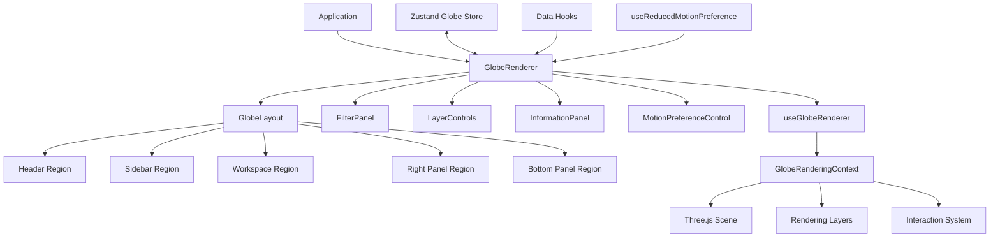
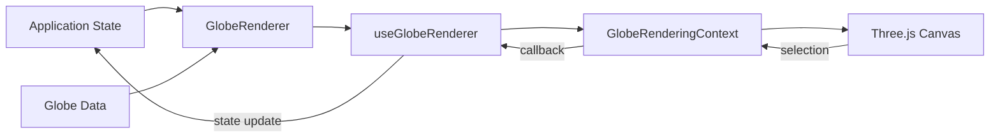
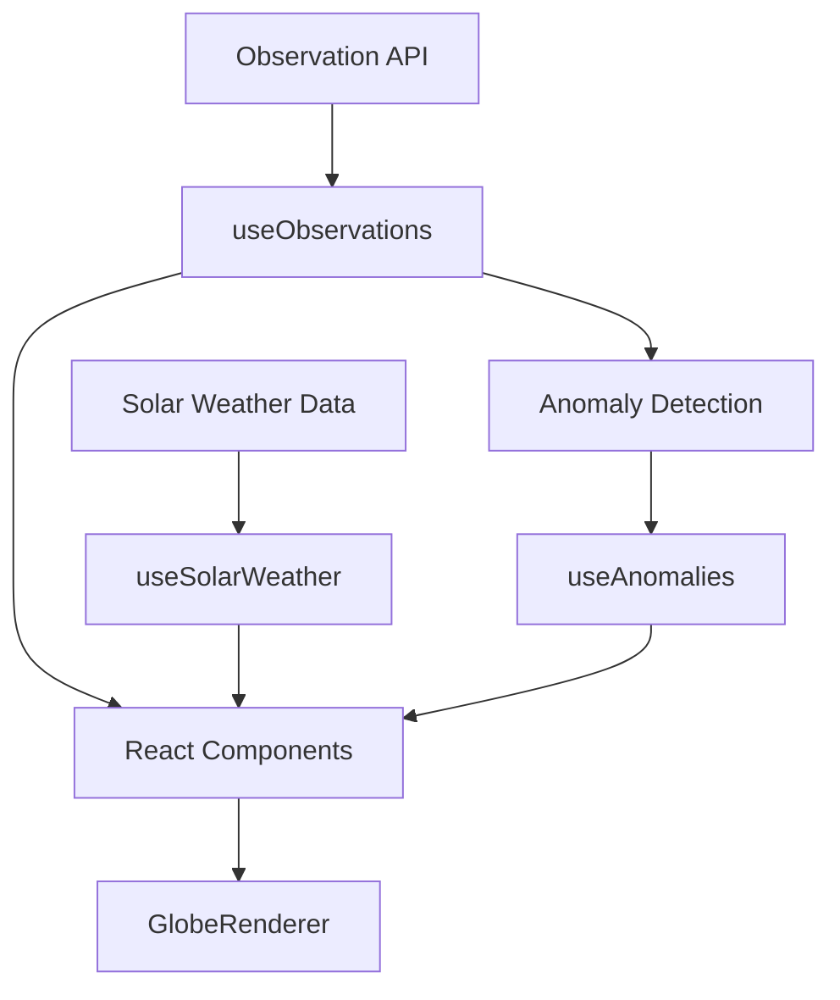
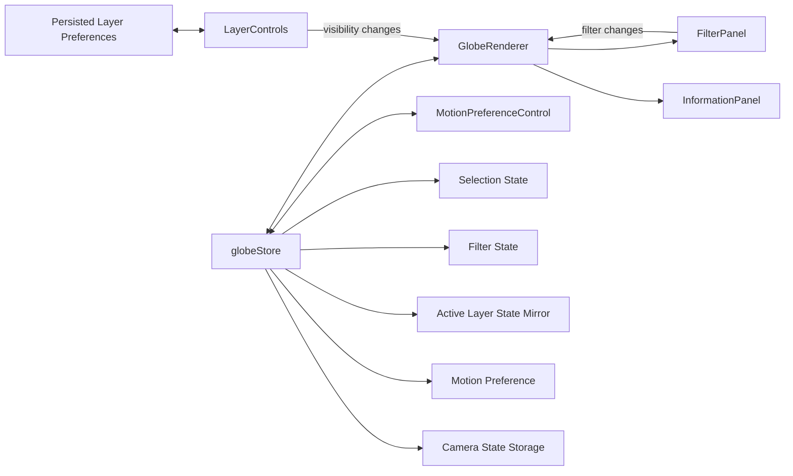
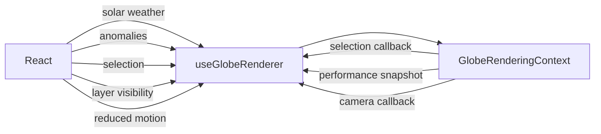
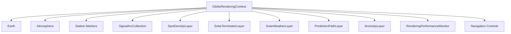
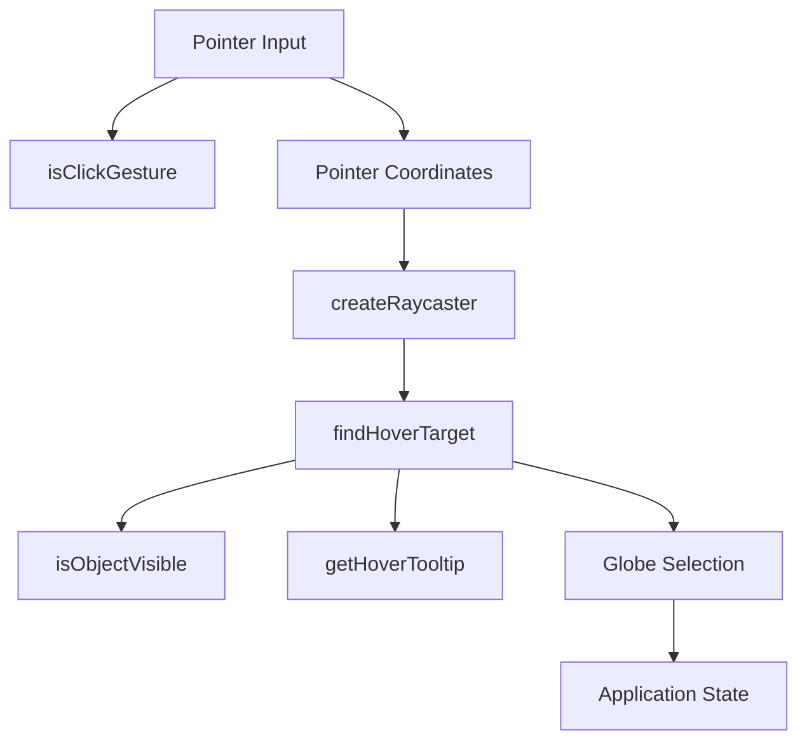

# Radio Weather Globe Component Diagrams

## Purpose

This document describes the major software components that make up the Radio
Weather Globe and the relationships between the React application, application
state, data hooks, and Three.js rendering subsystem.

For lower-level rendering lifecycle details, see
[`Globe_Architecture.md`](./Globe_Architecture.md).

## High-Level Component Architecture



The React component tree owns application composition and user-facing state.
`GlobeRenderingContext` owns the imperative WebGL subsystem.

## React Component Responsibilities

### `GlobeLayout`

`GlobeLayout` provides the structural application layout for the Radio Weather
Globe.

It accepts five React nodes and places them into the application's primary
layout regions:

- header
- sidebar
- workspace
- right information panel
- bottom activity panel

`GlobeLayout` does not compose the filtering, layer-management, motion,
information, or rendering components itself. `GlobeRenderer` composes those
functional components and supplies them to the appropriate layout regions.

The layout structure supports responsive arrangements while keeping component
composition separate from presentation.

### `GlobeRenderer`

`GlobeRenderer` is the React composition root for the interactive Radio Weather
Globe.

It retrieves application state and globe data, composes the user-interface
controls and information regions, supplies those regions to `GlobeLayout`, and
provides the DOM container used by Three.js.

It also connects application state and renderer inputs to `useGlobeRenderer`.

Its responsibility is orchestration rather than low-level rendering. Three.js
objects, frame updates, raycasting, and WebGL lifecycle management remain
inside the rendering subsystem.

Conceptually:



### `FilterPanel`

`FilterPanel` exposes observation-filtering controls.

Phase 2 supports filters for:

- band
- mode
- geographic region
- observation time

Filtering is application logic rather than rendering logic. `GlobeRenderer`
applies the selected filters to the retrieved observations.

In the current Phase 2 implementation, the filtered observations are used for
UI activity counts and anomaly derivation, but they are not yet forwarded
through `useGlobeRenderer` to populate the station, signal-path, or spot-density
rendering layers. Those layers therefore do not currently respond to
observation-filter changes.

This observation-to-renderer integration gap is tracked separately in the
Phase 2 review notes and must not be confused with the filtering utilities
themselves, which are implemented and tested.

Supporting filtering modules live under:

```text
src/globe/filters/
```

This includes pure filtering utilities and geographic-region logic that can be
tested independently of React.

### `LayerControls`

`LayerControls` presents the registered visualization layers to the user.

Individual visibility controls are represented by `LayerToggle`.

Layer preferences are persisted so that a user's visibility choices can be
restored across application loads.

The component does not manipulate Three.js scene objects directly. Visibility
changes are forwarded through the globe rendering boundary and ultimately
applied by the layer-management subsystem.

### `InformationPanel`

`InformationPanel` displays contextual information about the globe and current
selection.

Supporting presentation components include:

- `StationCard`
- `PathCard`
- `SummaryCard`

Selection state is application-visible state. A selection originating from
Three.js raycasting is propagated back into React so the information panel can
render the corresponding details.

### `MotionPreferenceControl`

`MotionPreferenceControl` allows the user to explicitly choose animation
behavior.

The application also observes the operating system's reduced-motion
preference through `useReducedMotionPreference`.

The resolved preference is converted to a boolean before it reaches the
Three.js rendering subsystem.

Rendering layers therefore do not need to query browser accessibility settings
directly.

## Data Hooks

The globe application uses focused hooks for external or derived data.



Phase 2 includes:

### `useObservations`

Retrieves radio observations for the globe application.

`GlobeRenderer` filters those observations for application-level use, including
activity counts and anomaly derivation. The current Phase 2 renderer integration
does not yet pass the filtered observation collection into `useGlobeRenderer`
for station, signal-path, or spot-density rendering.

Observation filtering remains separate from data retrieval.

### `useSolarWeather`

Provides the solar-weather snapshot consumed by the globe's solar
visualization layer.

### `useAnomalies`

Provides anomaly information for unusual radio conditions or contacts.

The resulting anomalies are forwarded into the rendering context rather than
being fetched by the Three.js layer itself.

## State Management

Globe application state is isolated in the Zustand globe store.



The store provides a shared application-state boundary without making the
Three.js render loop dependent on React updates.

`GlobeRenderer` is the primary Zustand consumer and supplies filter and
information state to child components through props and callbacks.
`MotionPreferenceControl` also accesses the store directly.

`LayerControls` owns persisted layer-visibility preferences separately and
reports visibility changes to `GlobeRenderer`. Zustand's active-layer state is
therefore a runtime application-state mirror rather than the persistence
mechanism for layer preferences.

Camera-state storage exists in the Phase 2 store, but camera position is not
continuously synchronized to Zustand during normal renderer navigation. The
interactive camera remains renderer-owned during normal operation.

## React-to-Renderer Boundary

`useGlobeRenderer` is the primary adapter between React and
`GlobeRenderingContext`.



This boundary is deliberately narrow.

React supplies state and data through explicit methods. The renderer reports
meaningful application events through callbacks.

High-frequency rendering state remains inside Three.js.

## Rendering Components

`GlobeRenderingContext` composes specialized rendering components rather than
implementing every visualization directly.



The rendering context coordinates these objects, while individual rendering
classes own visualization-specific behavior and resources.

## Interaction Components

Interaction behavior is separated into small utilities where possible.



This separation keeps calculations and hit-testing behavior independently
testable without requiring an entire React application or live WebGL scene.

## Utility Layer

Domain calculations live outside both React components and Three.js rendering
classes where practical.

Important utility groups include:

- geographic coordinate conversion
- coordinate normalization
- Maidenhead calculations
- great-circle path generation
- propagation-intensity mapping
- spot-density calculations
- solar position
- solar terminator calculations
- solar activity mapping
- prediction confidence
- anomaly detection and severity
- animation semantics
- transition standards
- motion-preference resolution

This structure keeps scientific and domain calculations reusable and
unit-testable.

## Component Dependency Rules

Phase 2 follows these dependency rules:

1. React components may depend on application state, hooks, types, and pure
   domain utilities.
2. React components should interact with Three.js through the globe rendering
   boundary rather than manipulating scene objects directly.
3. Rendering classes may depend on Three.js and pure domain utilities.
4. Rendering classes should not depend on React components or Zustand.
5. Domain utilities should remain independent of React and browser rendering
   whenever possible.
6. Visualization layers should receive their data explicitly.
7. Per-frame rendering should not trigger React or Zustand updates.
8. Browser accessibility preferences should be resolved before entering
   visualization layers.

These rules preserve a testable boundary between application behavior and the
WebGL rendering engine.

## Test Boundaries

The component architecture is tested at several levels.

| Boundary | Primary test type |
|---|---|
| Pure utilities | Vitest unit tests |
| Zustand state | Vitest unit tests |
| React controls and panels | React Testing Library |
| Rendering utilities and layers | Vitest unit tests |
| Complete rendered appearance | Playwright visual regression |
| User workflows | Playwright end-to-end tests |

This division allows most behavior to be validated without requiring WebGL
browser tests while retaining browser-level coverage for the integrated globe.

## Related Documentation

- [`Globe_Architecture.md`](./Globe_Architecture.md)
- [`Sequence_Diagrams.md`](./Sequence_Diagrams.md)
- [`Layer_Architecture.md`](./Layer_Architecture.md)
- [`../ux/Animation_Specification.md`](../ux/Animation_Specification.md)
- [`../ux/Wireframes.md`](../ux/Wireframes.md)
