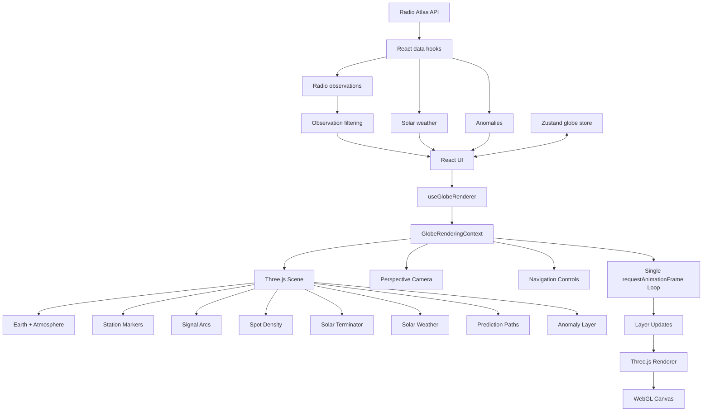
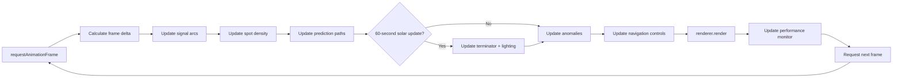
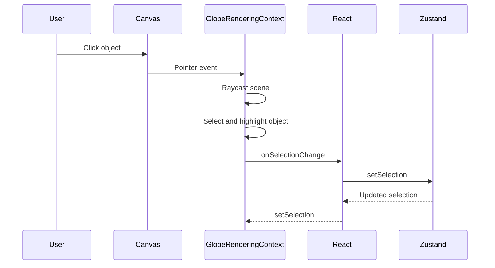

# Radio Weather Globe Architecture

## Purpose

The Radio Weather Globe is the primary visualization subsystem for
SolaraSphere: Radio Atlas.

It provides an interactive three-dimensional representation of radio and
space-weather conditions through visualization layers for stations, signal
paths, spot density, solar weather, propagation predictions, and detected
anomalies.

In the current Phase 2 implementation, solar-weather and anomaly data are
connected to the Three.js rendering pipeline. The station, signal-path, and
spot-density visualization capabilities are implemented, but filtered live
observations are not yet forwarded from the React application layer into those
rendering layers. Production prediction data is also not yet connected to the
prediction-path layer.

The architecture separates declarative application state and user interface
logic from the imperative Three.js rendering lifecycle. React owns the
application interface and data flow, while `GlobeRenderingContext` owns the
Three.js scene, renderer, camera, controls, render loop, and visualization
layers.

## Architectural Overview

The diagram intentionally shows filtered observations terminating at the React
UI rather than continuing into `useGlobeRenderer`. This reflects the current
Phase 2 implementation: filtered observations drive application-level
information and anomaly derivation, but the filtered observation collection is
not yet supplied to the station, signal-path, or spot-density rendering layers.

Similarly, `PredictionPathLayer` and its rendering-context API are implemented,
but production prediction data is not connected during Phase 2. Population of
that layer from the forecasting system is planned for Phase 4.

## System Boundaries

The globe is divided into two primary architectural domains.

### React application layer

React owns:

- application layout
- filter controls
- layer controls
- motion preferences
- information panels
- data-fetching hooks
- user-visible selection state
- application-level globe state

Zustand provides isolated globe state for filters, selections, active layers,
motion preferences, and camera-state storage.

React does not perform per-frame rendering.

### Three.js rendering layer

`GlobeRenderingContext` owns:

- the Three.js scene
- perspective camera
- WebGL renderer
- navigation controls
- Earth and atmosphere meshes
- visualization-layer instances
- raycasting and object selection
- pointer interaction
- tooltip behavior
- animation advancement
- rendering-performance monitoring
- the `requestAnimationFrame` lifecycle

This boundary prevents React component rendering from becoming coupled to the
high-frequency WebGL render loop.

## Renderer Lifecycle

`useGlobeRenderer` is the lifecycle bridge between React and the imperative
rendering subsystem.

When the globe component mounts, the hook:

1. creates one `GlobeRenderingContext`
2. registers the selection callback
3. restores known layer visibility
4. mounts the renderer canvas
5. starts the rendering loop
6. creates a `ResizeObserver`

The resize observer forwards container dimensions to the rendering context,
which updates both renderer size and camera aspect ratio.

When the React component unmounts, the hook:

1. disconnects the resize observer
2. disposes the rendering context
3. clears the context reference

`GlobeRenderingContext.dispose()` stops animation, clears interaction state,
removes the canvas and tooltip, disposes visualization layers and navigation
controls, unregisters pointer listeners, and disposes the Three.js renderer.

This lifecycle ensures that a mounted globe owns one rendering context and one
render loop.

## Rendering Pipeline

The rendering context uses a single `requestAnimationFrame` loop.

Animation layers receive the elapsed frame time and the resolved
reduced-motion preference.

Solar position is intentionally updated at a lower frequency. The terminator
and solar lighting are recalculated after the solar update accumulator reaches
60 seconds rather than every frame.

The renderer performs one scene render per animation frame.

## Scene Composition

The Three.js scene contains the following major visual systems:

| Scene element | Responsibility |
|---|---|
| Earth | Base planetary visualization |
| Atmosphere | Atmospheric visual treatment |
| Station markers | Geographic station locations |
| Signal arcs | Observed radio propagation paths |
| Spot density | Regional radio-activity density |
| Solar terminator | Day/night boundary |
| Solar weather | Solar and auroral conditions |
| Prediction paths | Forecast propagation paths |
| Anomaly layer | Unusual radio contacts and events |

Lighting consists of ambient and directional components. Solar-dependent
lighting is synchronized with the solar-position model.

## Data Flow

External and derived data enter the globe through explicit rendering-context
methods rather than allowing rendering classes to access React state directly.

Examples include:

- `setSolarWeatherSnapshot()`
- `setAnomalies()`
- `setPredictionPaths()`
- `setLayerVisible()`
- `setSelection()`
- `setReducedMotion()`

This keeps visualization behavior testable independently from React.

## State Synchronization

The React application uses Zustand for globe-related application state.

The renderer communicates user selection back to React through a selection
change callback. React can also synchronize an existing selection into the
rendering context.

Layer visibility is controlled by the application and forwarded to the
rendering context, where `LayerController` determines whether registered
visualization layers are visible.

Motion preference is resolved outside Three.js and passed to the rendering
context as a boolean. Rendering layers therefore do not depend directly on
browser media queries or Zustand.

### Camera state

The Zustand store defines camera-state storage and `GlobeRenderer` supplies a
camera-change callback to the rendering hook.

In the Phase 2 implementation, interactive camera operations are performed
directly through `GlobeRenderingContext` and its navigation controls. Camera
state is not continuously synchronized to Zustand during normal rotation and
zoom. The current rendering context reports camera state during disposal.

Camera interaction should therefore be treated as renderer-owned state in the
Phase 2 architecture. Continuous application-level camera synchronization can
be added later if a feature requires persisted or externally observable camera
position.

## Interaction Architecture

Pointer interactions are attached directly to the renderer canvas.

The rendering context handles:

- pointer down
- pointer up
- pointer movement
- pointer leave

Raycasting is used for station and signal-path hit detection.

Selection follows a bidirectional model:

Renderer-originated selection avoids callback recursion when the same
selection is synchronized back into the rendering context.

Keyboard interaction is routed through the React globe component and exposed
through rendering-context operations for rotation, zoom, center selection,
selection clearing, and camera reset.

## Layer Architecture

Visualization layers are managed through a layer registry and
`LayerController`.

The application controls visibility using stable `GlobeLayerId` values.
`GlobeRenderingContext` applies the resulting visibility state to scene
objects and specialized visualization-layer classes.

Layer implementations own their Three.js resources and are responsible for
disposing those resources when the rendering context is destroyed.

Detailed layer architecture is documented in
[`Layer_Architecture.md`](./Layer_Architecture.md).

## Animation Architecture

Animation is semantic rather than decorative.

Phase 2 defines:

- pulse as radio-activity density
- brightness as propagation strength
- dissolve as propagation-opening state
- sweep as terminator movement
- flare as anomaly severity

Animation layers advance through the shared globe render loop rather than
creating independent animation loops.

Reduced-motion behavior suppresses or simplifies nonessential motion while
preserving the underlying information.

Detailed timing and animation behavior are documented in
[`../ux/Animation_Specification.md`](../ux/Animation_Specification.md).

## Performance Architecture

Performance optimization is based on keeping the high-frequency rendering path
outside React and minimizing Three.js work.

Important Phase 2 decisions include:

- one `requestAnimationFrame` loop
- one Three.js render per frame
- no per-frame React or Zustand updates
- reusable layer objects
- batched or instanced rendering where appropriate
- explicit Three.js resource disposal
- lower-frequency solar-position updates
- reduced-motion support
- centralized performance sampling

`RenderingPerformanceMonitor` records rendering information including frame
performance and renderer resource statistics. Performance snapshots are
reported through an optional callback rather than stored on every frame.

## Phase 2 Performance Validation

The Phase 2 roadmap defines the following performance targets:

| Environment | Target |
|---|---:|
| Desktop | 60 FPS |
| Mobile | 30 FPS |

During Phase 2 profiling, the globe rendered at approximately 60 FPS on the
desktop development environment.

Responsive/mobile-profile testing also remained approximately 60 FPS, above
the Phase 2 30 FPS mobile target.

These measurements represent development-time validation rather than a formal
cross-device benchmark suite. Responsive browser emulation does not reproduce
the GPU and thermal characteristics of physical mobile hardware.

Future performance work should preserve a repeatable benchmark matrix across
representative physical devices and browsers.

The production build also currently reports a JavaScript bundle of
approximately 788 KB after minification. Vite reports this as exceeding its
default 500 KB chunk warning threshold. This is a bundle-size optimization
opportunity and is separate from the runtime FPS targets validated in Phase 2.

## Three.js and Deck.gl Decision

ADR-001 originally selected:

- Three.js as the primary globe-rendering engine
- Deck.gl for overlay rendering

The Phase 2 roadmap likewise listed Deck.gl overlays as a goal.

The completed Phase 2 implementation instead renders the globe and its
visualization overlays through the Three.js scene and specialized Three.js
layer classes.

Deck.gl is not part of the current frontend dependency or rendering pipeline.

This is an implementation deviation from the original architectural plan, not
an indication that the required overlay capabilities are absent. Spot density,
solar weather, prediction paths, anomalies, signal paths, and the solar
terminator are implemented directly in the Three.js subsystem.

The implemented architecture avoids coordinating two rendering engines and
keeps visualization lifecycle, animation, selection, visibility, and resource
disposal under one rendering context.

ADR-001 should be amended or superseded if the project formally adopts this
Three.js-only overlay architecture for future phases. Deck.gl can still be
reconsidered if future visualization volume or geospatial requirements provide
a concrete reason to introduce it.

## Testing Strategy

The globe architecture is protected at three levels.

### Unit tests

Unit tests validate:

- geographic coordinate conversion
- great-circle calculations
- layer management
- filtering
- animation semantics
- rendering utilities
- state behavior
- interaction helpers

### Visual regression tests

Playwright visual tests validate:

- base globe rendering
- signal paths
- spot-density overlays
- animation behavior

### End-to-end tests

Playwright E2E tests validate:

- persisted layer visibility
- observation filtering and reset
- station selection and clearing
- keyboard camera rotation and camera reset

## Architectural Constraints

Future globe work should preserve the following Phase 2 invariants:

1. React should not become the per-frame rendering engine.
2. The globe should maintain a single rendering context per mounted instance.
3. Rendering should use a single animation loop unless a documented
   architectural requirement demands otherwise.
4. Visualization layers should receive explicit data rather than reading
   application state implicitly.
5. Three.js resources must be disposed when their owning layer or rendering
   context is destroyed.
6. Selection synchronization must avoid callback loops.
7. Reduced-motion state should be resolved outside visualization layers.
8. Animation should communicate domain information rather than exist solely
   for decoration.
9. Runtime performance and static bundle size should be evaluated separately.
10. Rendering-engine changes should be captured in an ADR.

## Related Documentation

- [`Component_Diagrams.md`](./Component_Diagrams.md)
- [`Sequence_Diagrams.md`](./Sequence_Diagrams.md)
- [`Layer_Architecture.md`](./Layer_Architecture.md)
- [`../ux/Animation_Specification.md`](../ux/Animation_Specification.md)
- [`../ux/Wireframes.md`](../ux/Wireframes.md)
- [`../adr/adr-001.md`](../adr/adr-001.md)
