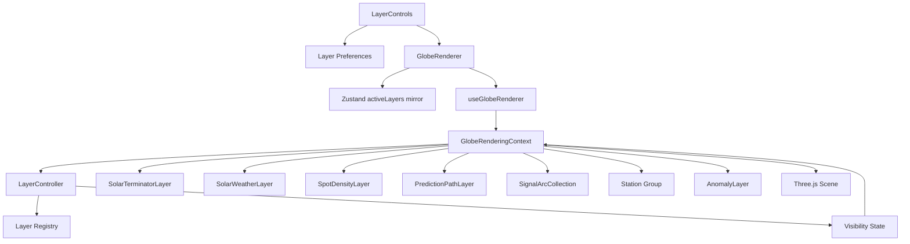
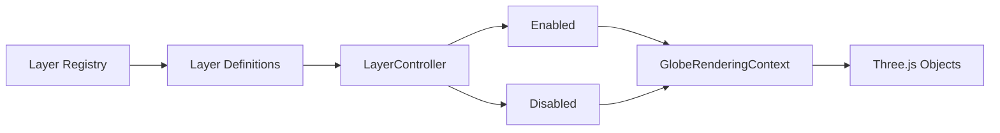
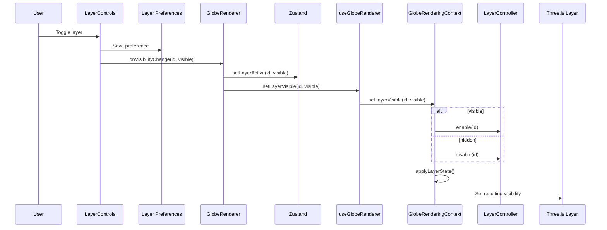
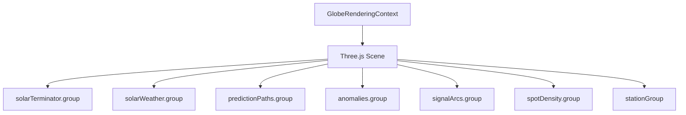
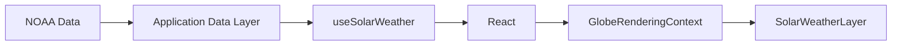
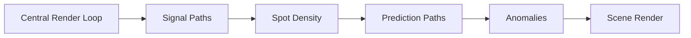
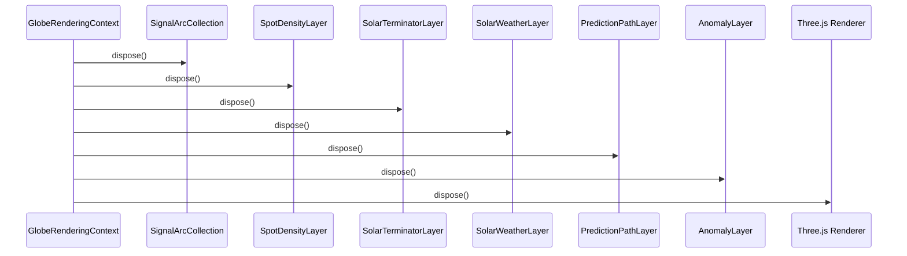

# Radio Weather Globe Layer Architecture

## Purpose

The Radio Weather Globe uses a layered visualization architecture so that
independent scientific and radio-data views can be enabled, disabled, updated,
animated, and disposed without coupling those behaviors to React components.

This document describes the layer registry, layer controller, rendering-layer
ownership, visibility flow, animation behavior, and resource lifecycle.

For the overall renderer architecture, see
[`Globe_Architecture.md`](./Globe_Architecture.md).

## Layer Architecture Overview



The application controls which conceptual layers are active. The rendering
context translates that state into visibility changes on Three.js scene
objects.

## Registered Layers

Phase 2 defines the following globe-layer identifiers:

| Layer | Purpose |
|---|---|
| `solar-terminator` | Displays the day/night boundary |
| `solar-weather` | Displays solar and auroral conditions |
| `spot-density` | Displays geographic concentration of radio activity |
| `prediction-paths` | Displays predicted propagation openings |
| `signal-paths` | Displays observed propagation paths |
| `stations` | Displays geographic station markers |
| `anomalies` | Highlights unusual radio contacts or conditions |

Stable identifiers allow the application, persistence system, and renderer to
refer to the same conceptual layers without exposing Three.js objects to the
React UI.

## Registry and Controller

The layer-management subsystem separates layer definition from active
visibility state.



### Layer registry

The registry defines the set of layers understood by the application.

The registry provides a stable source for layer metadata rather than requiring
the UI or rendering context to independently maintain competing lists of
available layers.

### `LayerController`

`LayerController` owns layer-enabled state.

It supports operations such as:

- enable a layer
- disable a layer
- toggle a layer
- query whether a layer is visible

`GlobeRenderingContext` uses the controller rather than allowing individual UI
components to manipulate scene visibility directly.

## Visibility Flow

A user visibility change crosses the React/rendering boundary through an
explicit API.



The layer UI therefore remains independent from Three.js implementation
details.

## Preference Persistence

Layer visibility preferences are persisted outside the rendering subsystem.

When the globe rendering context is created, `useGlobeRenderer` retains known
layer visibility values and applies them to the newly created context before
normal rendering begins.

This keeps persistence concerns outside Three.js while allowing renderer
recreation without discarding the user's visibility choices.

## Rendering Ownership

Not every conceptual layer is represented by the same kind of Three.js
object.

Some layers are specialized rendering classes:

- `SolarTerminatorLayer`
- `SolarWeatherLayer`
- `SpotDensityLayer`
- `PredictionPathLayer`
- `AnomalyLayer`

Observed signal paths are managed by:

- `SignalArcCollection`

Stations are represented by a Three.js group containing station-marker
objects.

`GlobeRenderingContext` owns these top-level rendering systems and adds their
groups or objects to the scene.



This gives the rendering context a consistent visibility boundary even when
the internal implementation of individual layers differs.

## Signal Paths

`SignalArcCollection` manages observed radio propagation paths.

Signal paths:

- follow great-circle routes
- support multiple simultaneous paths
- derive visual intensity from propagation strength
- update brightness through the central animation loop
- participate in selection and hover interaction

Brightness communicates propagation strength rather than serving as decorative
animation.

With reduced motion enabled, the layer can simplify motion behavior while
preserving the information represented by the signal path.

## Spot Density

`SpotDensityLayer` provides the rendering capability for visualizing geographic
concentrations of radio observations.

The density utilities aggregate observation locations into density regions that
are supplied to the rendering layer. In the current Phase 2 implementation,
filtered live observations are adapted into geographic activity points from
valid sender and receiver endpoints. Those points are aggregated into density
regions and supplied to `SpotDensityLayer` through the React-to-renderer
boundary.

The production rendering context does not create seeded observation data for
this layer. Filter changes therefore propagate through the observation
visualization adapter and update the density regions rendered on the globe.

When observation-derived density data is supplied, density controls the visual
treatment of the resulting markers. Pulse behavior communicates activity
level, so regions with greater activity produce stronger density feedback.

The implementation keeps density calculation separate from Three.js rendering,
allowing aggregation behavior to be unit-tested independently.

## Solar Terminator

`SolarTerminatorLayer` displays the boundary between illuminated and
non-illuminated portions of Earth.

Its geometry is derived from solar-position calculations and current time.

Unlike decorative animation, terminator movement represents changing physical
conditions. It therefore continues to update even when reduced motion is
requested.

The rendering context updates the terminator and corresponding solar lighting
at a lower frequency than the normal animation frame rate.

## Solar Weather

`SolarWeatherLayer` represents solar and auroral conditions.

The layer receives a `SolarWeatherSnapshot` explicitly through
`GlobeRenderingContext.setSolarWeatherSnapshot()`.

The rendering layer does not fetch NOAA data directly.

This preserves the boundary:



Solar-weather rendering uses batched or instanced geometry where appropriate
to reduce draw-call and geometry overhead.

## Prediction Paths

`PredictionPathLayer` displays forecast propagation paths separately from
observed signal paths.

Prediction paths are visually differentiated through:

- dashed treatment
- confidence-derived appearance
- opening and closing dissolve transitions

Prediction confidence determines the steady-state presentation of a path.
Presence in the current prediction set determines whether a predicted opening
is appearing, steady, or disappearing.

A disappearing path remains alive until its transition completes. Its Three.js
resources are then removed and disposed.

If the same prediction returns before disappearance completes, the existing
object can transition back toward its visible state instead of being
unnecessarily rebuilt.

## Anomalies

`AnomalyLayer` highlights unusual radio contacts or conditions.

Anomaly detection occurs outside the rendering class. The renderer receives
already-derived anomaly objects through:

```text
GlobeRenderingContext.setAnomalies()
```

Severity controls the anomaly's visual treatment, including flare behavior.

This separation prevents the visualization layer from becoming responsible for
deciding what constitutes an anomaly.

## Stations

Station markers represent geographic locations on the globe.

Stations are converted from latitude and longitude to Three.js globe
coordinates and placed slightly above the Earth's surface.

Station objects participate in:

- pointer hover
- tooltips
- raycast selection
- selection highlighting
- information-panel synchronization

The station layer is represented by the shared `stationGroup` rather than a
specialized animated-layer class because stations do not require their own
per-frame update lifecycle.

## Layer Animation

Animated layers do not create independent `requestAnimationFrame` loops.

Instead, `GlobeRenderingContext` advances animation from the central rendering
loop.



This makes frame timing easier to coordinate and prevents multiple competing
animation loops.

The detailed semantic rules are documented in
[`../ux/Animation_Specification.md`](../ux/Animation_Specification.md).

## Reduced Motion

Reduced-motion preference is resolved at the application level and passed to
the rendering context as a boolean.

Animated layers receive the resolved value during their normal update calls.

This design means:

- rendering classes do not access `matchMedia`
- rendering classes do not access Zustand
- accessibility policy remains centralized
- animation behavior remains independently testable

Reduced motion changes presentation, not the underlying scientific state.

## Layer Ordering

Layer ordering is managed by the rendering subsystem rather than by React
component order.

The Three.js scene contains the Earth, atmosphere, radio-data layers,
environmental layers, predictions, anomalies, and station markers as
independent scene objects or groups.

When introducing a new layer, its visual relationship to existing globe
surfaces and overlays should be considered explicitly, including:

- surface radius or offset
- transparency
- blending behavior
- depth testing
- render order when necessary
- interaction priority

A new layer should not rely accidentally on insertion order to resolve visual
conflicts.

## Interaction Priority

Interactive layers participate in raycasting through the rendering context.

Selection prioritizes supported selectable object types rather than exposing
arbitrary Three.js intersections to React.

Phase 2 selection supports stations and signal paths.

Hover behavior similarly resolves renderer intersections into meaningful
domain objects before presenting tooltips or highlights.

Layer visibility is considered during interaction so hidden objects do not
remain unintentionally selectable.

## Resource Lifecycle

Rendering layers own the Three.js resources they create.

A layer that creates geometry, material, mesh, or instanced rendering resources
is responsible for disposing those resources when they are no longer needed.

At globe shutdown:



Dynamic layers must also dispose obsolete resources during normal updates
rather than waiting for the entire globe to unmount.

This is particularly important for visualizations whose contents change as new
observations, predictions, or environmental conditions arrive.

## Adding a New Layer

A future Phase 3+ visualization should follow the existing layer boundary.

The typical process is:

1. Define a stable `GlobeLayerId`.
2. Add layer metadata to the registry.
3. Determine its default visibility.
4. Implement domain calculations outside Three.js when practical.
5. Implement a rendering class or scene group.
6. Add the layer to `GlobeRenderingContext`.
7. Connect its visibility to `applyLayerState()`.
8. Feed data through an explicit rendering-context method.
9. Advance animation through the existing render loop if animation is needed.
10. Respect reduced-motion behavior.
11. Dispose all owned Three.js resources.
12. Add unit tests for calculations and layer behavior.
13. Add visual or E2E coverage when the layer changes user-visible behavior.
14. Document new animation semantics if the layer introduces a new visual
    language.

A new visualization should not introduce a second animation loop, direct
Zustand dependency, or hidden data-fetching behavior inside the rendering
class.

## Three.js Overlay Implementation

The original Phase 2 architecture proposed using Deck.gl for overlay rendering.

The completed Phase 2 layer system instead implements overlays directly using
Three.js.

Consequently, layer visibility, animation, raycasting, resource lifecycle, and
scene composition are coordinated through one rendering engine and one
`GlobeRenderingContext`.

This deviation is described in more detail in
[`Globe_Architecture.md`](./Globe_Architecture.md).

A future decision to introduce Deck.gl should be based on a demonstrated
visualization or performance requirement and recorded through an ADR rather
than added solely to conform to the original Phase 2 proposal.

## Testing

Layer behavior is covered through several test levels.

Unit tests cover:

- layer registry behavior
- layer-controller behavior
- preference persistence
- visibility management
- density calculations
- signal-path rendering calculations
- solar terminator calculations
- solar-weather visualization behavior
- prediction-path behavior
- anomaly behavior

Visual regression tests use deterministic API-backed observations to cover
observation-derived rendering, including signal paths and spot density, while
also verifying full-motion density animation.

End-to-end tests verify user-visible layer toggling and persistence, live
observation-backed station selection, filter-to-renderer synchronization, and
camera interaction.

## Architectural Invariants

Future work should preserve these layer-system invariants:

1. Layer identifiers remain stable application-level concepts.
2. React controls do not manipulate Three.js objects directly.
3. Visualization layers receive data explicitly.
4. Domain calculations remain outside rendering classes where practical.
5. Animated layers use the shared render loop.
6. Hidden layers do not remain unintentionally interactive.
7. Reduced-motion policy is resolved outside rendering classes.
8. Dynamic Three.js resources are disposed when obsolete.
9. Layer visibility survives renderer recreation when preferences require it.
10. New rendering-engine dependencies require an explicit architectural
    decision.

## Related Documentation

- [`Globe_Architecture.md`](./Globe_Architecture.md)
- [`Component_Diagrams.md`](./Component_Diagrams.md)
- [`Sequence_Diagrams.md`](./Sequence_Diagrams.md)
- [`../ux/Animation_Specification.md`](../ux/Animation_Specification.md)
- [`../ux/Wireframes.md`](../ux/Wireframes.md)
