# Radio Weather Globe Sequence Diagrams

## Purpose

This document describes the major runtime interactions within the Radio Weather
Globe.

The diagrams focus on boundaries where control or data moves between React,
Zustand application state, the Three.js rendering subsystem, visualization
layers, and user interaction.

For the overall system structure, see
[`Globe_Architecture.md`](./Globe_Architecture.md).

## Globe Initialization

The React application owns creation and destruction of the imperative Three.js
rendering context through `useGlobeRenderer`.

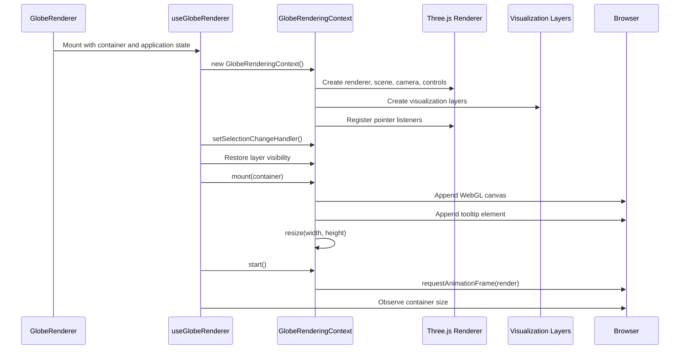

The rendering context owns one Three.js renderer and one animation loop for the
mounted globe.

## Globe Disposal

React also owns the lifetime boundary for renderer cleanup.

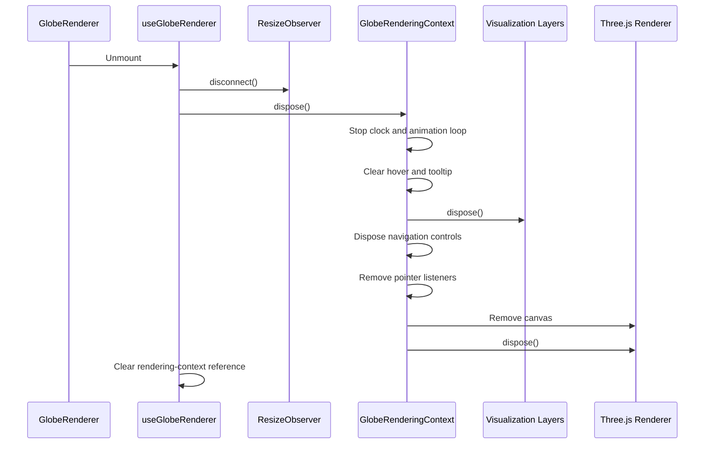

Explicit disposal prevents stale canvases, event listeners, animation loops,
and GPU resources from surviving a React unmount.

## Render Loop

All animated globe layers advance through the central rendering loop.

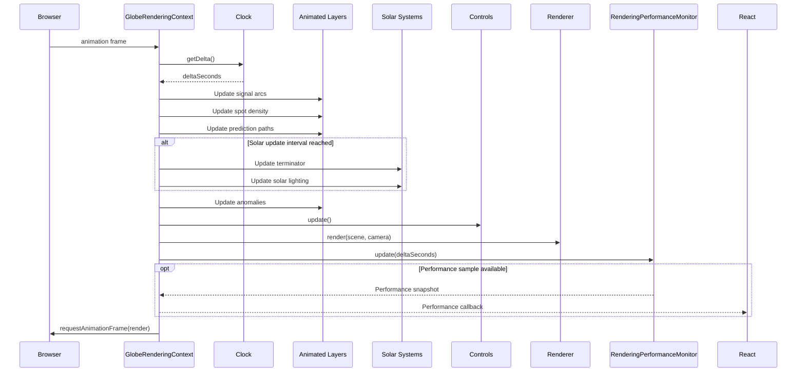

There is no independent animation loop for individual visualization layers.

## Observation Retrieval and Filtering

Observation retrieval and filtering remain outside the Three.js rendering
classes.

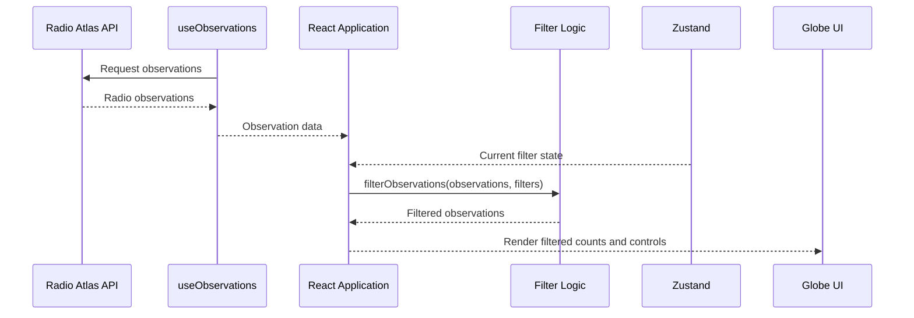

Filter calculations are pure application logic. They can therefore be tested
without a Three.js scene or browser WebGL context.

## Filter Interaction

When the user changes a filter, `FilterPanel` reports the change to
`GlobeRenderer`, which updates the filter state in Zustand. The updated state
then drives application-level observation filtering.

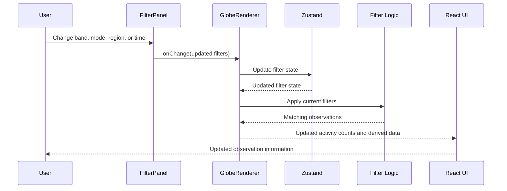
In the current Phase 2 implementation, this sequence does not continue from
the filtered observation collection into the Three.js station, signal-path, or
spot-density layers. Filter changes therefore update application-level
observation information but do not yet alter those rendered observation
layers.

Resetting the filters follows the same state-update path, with the store
returning filter values to their defaults.

## Layer Visibility

Layer controls do not manipulate Three.js scene objects directly.

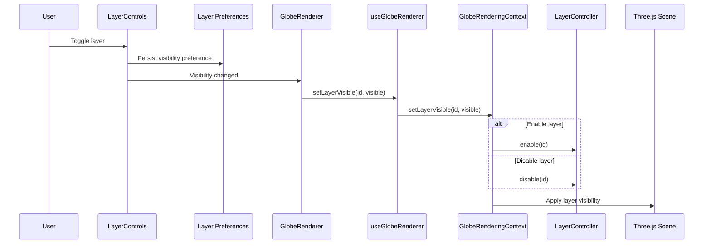

Persisted preferences allow layer choices to survive an application reload.

## Pointer Hover

Hover interaction is renderer-owned because it depends on the Three.js scene
and raycasting.

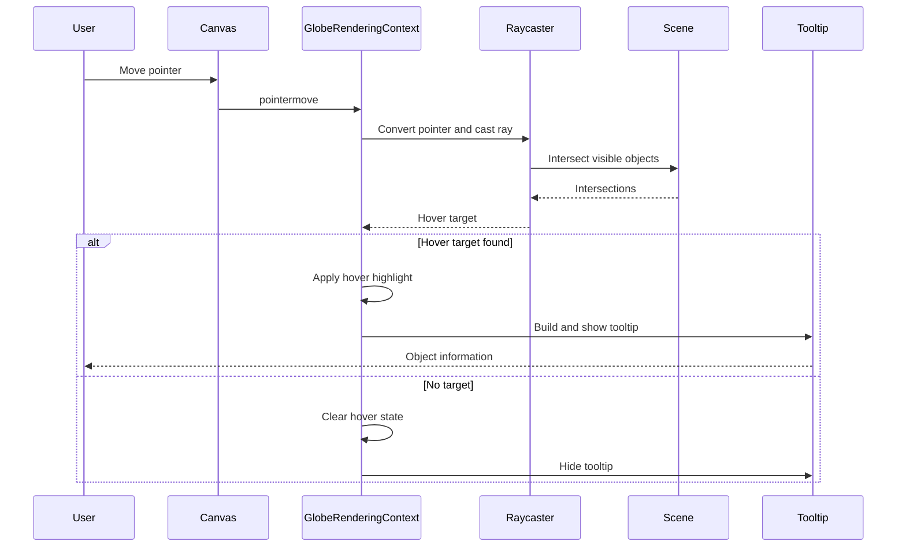

Hover state remains inside the renderer because it is transient presentation
state and does not need to drive React application state.

## Pointer Selection

Selection crosses the renderer/application boundary because selected-object
details are displayed by React.

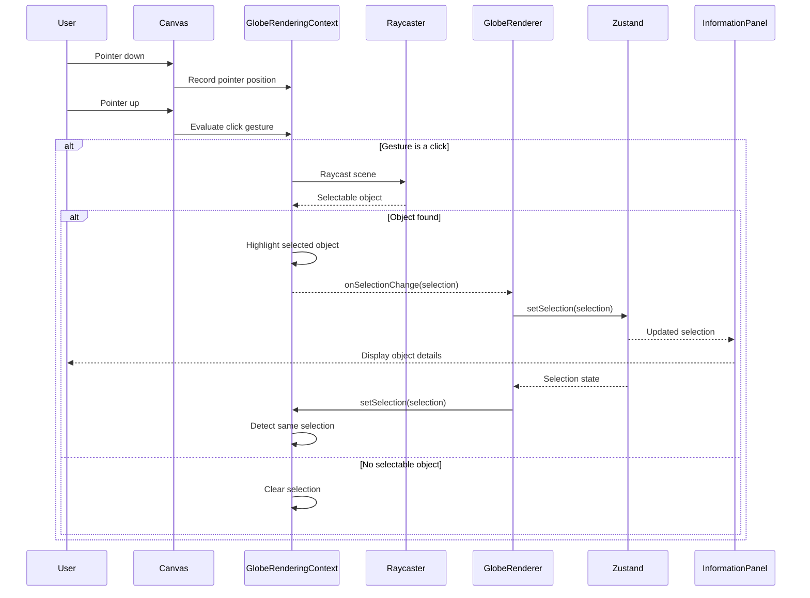

The renderer recognizes an already-selected object when React synchronizes the
same selection back into the context. This prevents redundant selection work
and callback recursion.

## Selection Initialization

Selection callbacks must be installed after the rendering context exists.

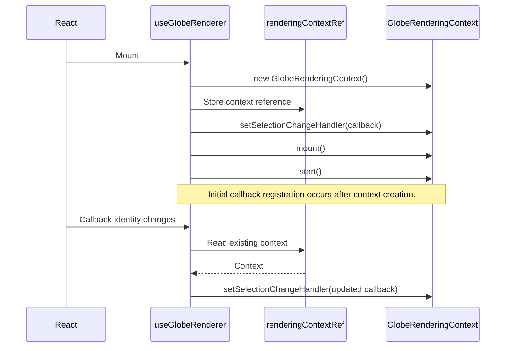

This ordering is important. Registering the initial callback only in an effect
that executes before the context exists leaves the Three.js renderer without a
selection callback until that callback later changes.

The Phase 2 end-to-end selection test protects this integration boundary.

## Keyboard Globe Navigation

Keyboard input is scoped to the focused globe application rather than being
registered as an unrestricted global shortcut.

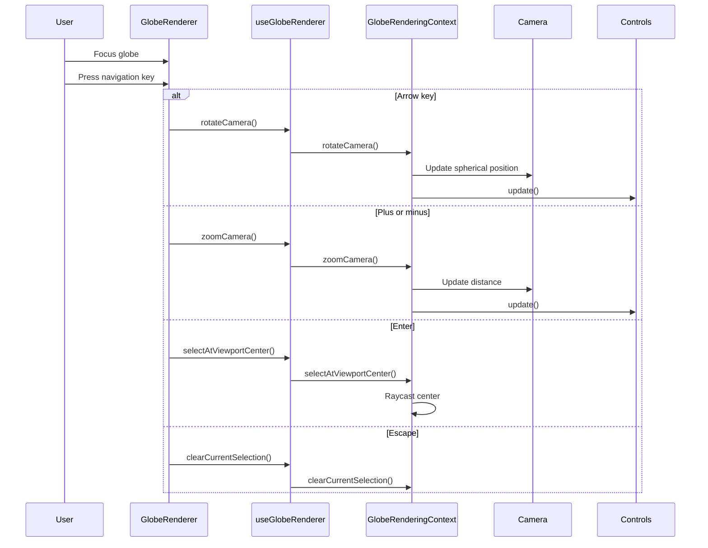

The camera is manipulated through the rendering context rather than directly
from React.

## Camera Reset

Camera reset delegates to the existing navigation-control state.

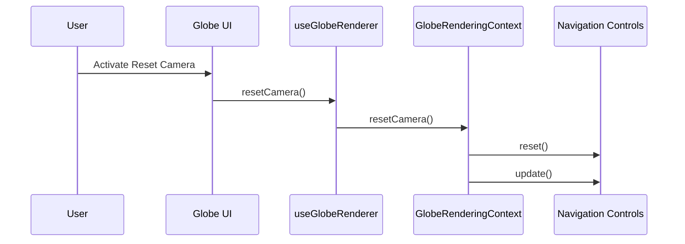

The Phase 2 end-to-end suite verifies that rotation changes the visible globe
state and that resetting the camera restores the initial selection geometry.

## Solar Weather Update

Solar-weather data enters the rendering system explicitly through the React
adapter.

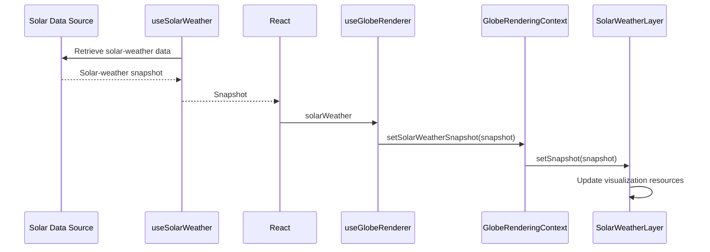

The Three.js solar-weather layer does not retrieve NOAA or API data itself.

## Anomaly Update

Anomaly detection and rendering are similarly separated.

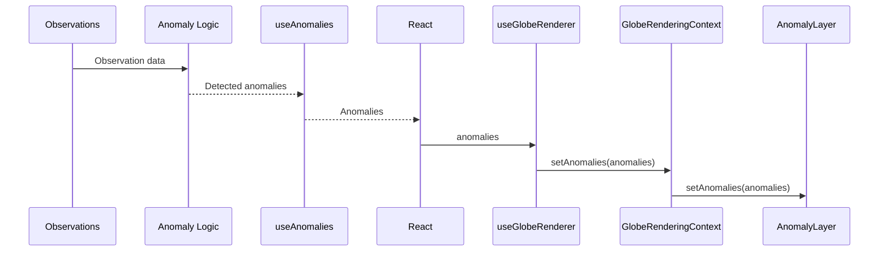

Detection remains testable independently from Three.js rendering.

## Reduced-Motion Flow

Accessibility preferences are resolved outside visualization layers.

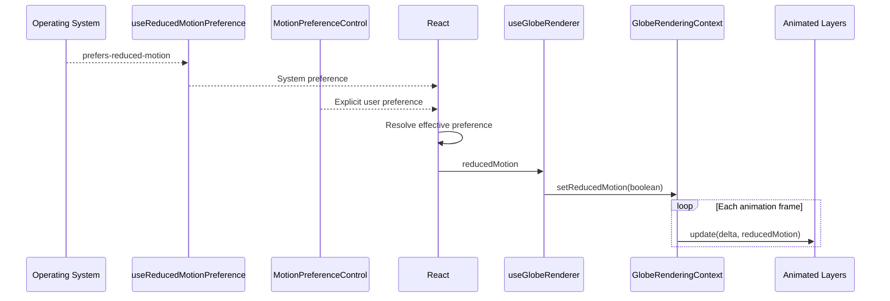

This design keeps accessibility policy outside individual Three.js layers while
allowing those layers to adjust their presentation.

## Performance Reporting

Performance sampling is part of the rendering loop but is not propagated to
React every frame.

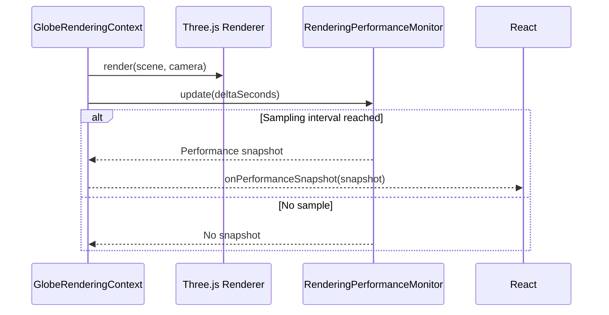

This prevents performance instrumentation itself from creating a per-frame
React update path.

## Related Documentation

- [`Globe_Architecture.md`](./Globe_Architecture.md)
- [`Component_Diagrams.md`](./Component_Diagrams.md)
- [`Layer_Architecture.md`](./Layer_Architecture.md)
- [`../ux/Animation_Specification.md`](../ux/Animation_Specification.md)
- [`../ux/Wireframes.md`](../ux/Wireframes.md)
